<div dir="rtl">

<p align="center">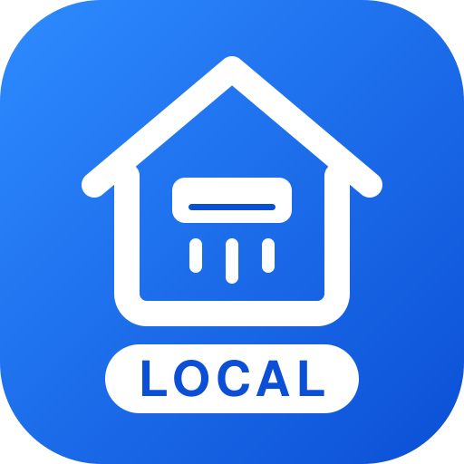</p>

# homebridge-samsung-local

<p align="center">
<a href="https://github.com/homebridge/homebridge/wiki/Verified-Plugins"></a>
<a href="https://www.npmjs.com/package/homebridge-samsung-local"></a>
<a href="https://github.com/Abdulazizruh/homebridge-samsung-local/actions/workflows/ci.yml"></a>
<br>
<a href="https://www.npmjs.com/package/homebridge-samsung-local"></a>
<a href="https://www.npmjs.com/package/homebridge-samsung-local"></a>
<br>
<a href="https://github.com/Abdulazizruh/homebridge-samsung-local/stargazers"></a>
<a href="https://github.com/Abdulazizruh/homebridge-samsung-local/issues"></a>
<a href="LICENSE"></a>
<br>
<a href="https://github.com/Abdulazizruh/homebridge-samsung-local/commits/main"></a>
<br>
<a href="https://nodejs.org"></a>
</p>

تحكم محلي بأجهزة Samsung من تطبيق Apple Home، دون السحابة: المكيفات، والغسالات بحالتها وإشعار انتهاء الدورة والتحكم بالبرنامج والإعدادات، والتلفزيونات مع ريموت مركز التحكم.

| | |
|---|---|
| **دون API من SmartThings** | **لا يحتاج تسجيل دخول إلى SmartThings ولا رمز دخول ولا API ولا اشتراك.** ليس مبنيًا على OAuth من SmartThings: الإضافة لا تسجّل الدخول إلى Samsung أبدًا، فتعمل حتى حيث لا تتوفر خدمة SmartThings API. ويعمل دون Home Assistant أو HACS أو MQTT |
| **داخل البيت** | **يعمل من أول دقيقة** على شبكة البيت: Apple Home ← Homebridge ← الجهاز مباشرة |
| **اختياري: الأسماء من SmartThings** | **لا يلزم، ولا تعتمد عليه الإضافة أبدًا.** إذا كانت أجهزتك كثيرة، يمكن استعمال رمز من SmartThings تنشئه بنفسك **مرة واحدة** لجلب أسمائها وغرفها تلقائيًا بدل كتابتها. لا تتحكم الإضافة بشيء عن طريقه. راجع [الأسماء من SmartThings](#الأسماء-من-smartthings-اختياري) |
| **من خارج البيت** | **من أول يوم** مع مركز منزلي من Apple في البيت: **Apple TV أو HomePod أو HomeView**. تحكم وإشعارات، مثل أي ملحق في Apple Home |

<sub>المكيفات والغسالات يكفي أن تكون على شبكة Wi-Fi البيت، وهذا تضبطه Samsung مرة واحدة بتطبيق SmartThings عند تركيب الجهاز. والتلفزيونات لا تحتاج شيئًا: تختار «Allow» على التلفزيون مرة واحدة.</sub>

[English](README.md)

> **الحالة: 1.9.11. مجرَّبة على أجهزة حقيقية.** تعمل يوميًا في بيت واحد على خمسة مكيفات من فئتَي موديلات (`ARTIK051_PRAC_20K` و `TP1X_DA-AC-RAC-01001`) وغسالة واحدة (`WA80F16B9CYL`) وأربعة تلفزيونات (`UA55KU7000` و `QA50Q60D` و `QA65QN70F` و `QA75QN85D`)، و Homebridge داخل Docker على Raspberry Pi. تعرض الإضافة المزايا التي يعلنها جهازك، فالنتيجة تعتمد على الجهاز المستهدف. راجع [ما تم اختباره](#ما-تم-اختباره).
> مشروع غير رسمي، وليس تابعًا لشركة Samsung أو معتمدًا منها.

## ما الذي يقدمه

| البند | التفاصيل |
|---|---|
| الحساب | **لا يلزم.** لا حساب SmartThings يلزم، ولا رمز دخول ولا API ولا اشتراك: الإضافة تتحدث مع كل جهاز داخل شبكة البيت فقط. يكفي أن يكون الجهاز متصلًا بشبكة Wi-Fi البيت، وهذا يتم عادة مرة واحدة بتطبيق SmartThings عند تركيبه، وأن يبقى مسجّلًا فيه. والتلفزيونات لا تحتاج SmartThings أصلًا: تختار «Allow» على التلفزيون مرة واحدة |
| من خارج البيت | **نعم، مع مركز منزلي من Apple** (Apple TV أو HomePod أو HomeView) في البيت، كأي ملحق في Apple Home: التحكم والإشعارات تعمل من أي مكان من أول يوم. أما الريموت الذي مثل Apple TV في مركز التحكم فيعمل داخل شبكة البيت فقط |
| الاتصال | المكيفات والغسالات: CoAP عبر DTLS داخل الشبكة المحلية. التلفزيونات: قناة التحكم المحلية الخاصة بالتلفزيون |
| المحرك | تختار واحدًا من الإعدادات. **JavaScript**: يعمل دون أي تجهيز. **Python**: مكتبة [`smartthings-local`](https://github.com/QuiteYellow/SmartThings-Local) في بيئة خاصة. الاثنان يؤديان العمل نفسه، ويعرض كل جهاز زمن استجابة أوامره مع المحرك المستخدم، فتقارن بينهما على أجهزتك |
| الإعداد | اضغط **مسح الشبكة** في إعدادات الإضافة وحدّد ما تريد إضافته، أو أدخل عنوان IP أو MAC لجهاز واحد ثم اضغط **اختبار واكتشاف** |
| الهوية | يُعرَّف كل جهاز بمعرّفه الثابت، فتغيير العنوان لا ينشئ جهازًا مكررًا. المكيف أو الغسالة إذا تغيّر عنوانه تجده الإضافة بنفسها |
| الأسماء | كل جهاز يُعثر عليه يأتي باسم تبدأ منه، ومعه مصدره: اسمه السابق في هذه الإضافة، أو اسمه وغرفته في SmartThings (مع [الاستيراد الاختياري](#الأسماء-من-smartthings-اختياري))، أو اسمه في `homebridge-smartthings-oauth` (بالمعرّف نفسه، للقراءة فقط)، أو اسمه الذي يرسله (التلفزيونات)، أو اسم مقترح مرقّم مثل «مكيف 1». ويعرض البحث ما يفعله كل جهاز الآن (يعمل، الوضع، الحرارة المضبوطة) لتعرف أيها في أي غرفة. ويُحفظ فقط الاسم الذي تكتبه بيدك (في البحث، أو في الإضافة اليدوية، أو بالقلم): يبقى محفوظًا بعد حذف الجهاز، فيعود به إن أضفته مرة أخرى. أما الاسم المقترح إذا تركته كما هو («مكيف 1»، أو اسم التلفزيون الذي يرسله) فيُستعمل ولا يُحفظ. ويأخذ الاسم المرقّم أصغر رقم غير مستعمل بين أسماء أجهزتك الحالية، فإذا غيّرت أسماءها يبدأ الترقيم من 1 مرة أخرى. و«حذف بيانات هذه الإضافة» يمسح الأسماء المحفوظة أيضًا |
| التحديثات | فورية حيث يدعمها الجهاز، مع قراءة دورية كبديل كل 5 ثوانٍ افتراضيًا (4 ثوانٍ على الأقل) |
| العمل دون إنترنت | نعم، بعد الإعداد الأول |
| التشغيل بالتوازي | يعمل بجانب `homebridge-smartthings-oauth` وأي إضافة أخرى دون المساس بملفاتها |

### الأجهزة المدعومة

| الجهاز | مستوى الدعم | ملاحظات |
|---|---|---|
| المكيفات، ومنها WindFree (`ARTIK051_PRAC_20K` و `TP1X_DA-AC-RAC-01001`) | **مجرَّب على أجهزة حقيقية** | جهاز HomeKit كامل، مبني على خرائط LocalThings |
| الغسالات | **مجرَّب على غسالة واحدة**، والتحكم تجريبي | بطاقة تبيّن أن الدورة تعمل والوقت المتبقي، وحساس يتفعّل عند انتهاء الدورة (للإشعارات)، والقدرة والطاقة في Eve. تجريبي ومفعّل تلقائيًا: حساس لكل مرحلة (غسيل، شطف، عصر) وحساس لتنظيف الحوض. اختياريًا: نسبة التقدم، وحالة قفل الأطفال، وتنبيه الأعطال، وتذكير إخراج الغسيل كل نصف ساعة ما دام في الداخل. تبدأ الدورة من الجهاز نفسه، ولا يُرسل إليه أي أمر إلا إذا اخترت [تحكمًا تجريبيًا](#التحكم-بالغسالة-تجريبي)، وهو مطفأ افتراضيًا وجُرِّب على غسالة علوية واحدة |
| تلفزيونات Samsung (نظام Tizen، من 2016 فأحدث) | **مجرَّب على أربعة تلفزيونات** | يقترن مرة واحدة من صفحة الإعدادات وأنت أمام التلفزيون (اختر «سماح» على شاشته). يظهر بطاقة تلفزيون مع ريموت مركز التحكم، أو مفاتيح داخل الجسر: تشغيل وكتم وصوت |
| المجففات وغسالات الصحون | **المتابعة نفسها، ولم تُجرَّب بعد على جهاز حقيقي** | مبنية على قراءات الغسالة نفسها |
| منقيات الهواء ومزيلات الرطوبة | **تجريبي، ولم يُجرَّب بعد على جهاز حقيقي** | جودة الهواء والرطوبة كحساسات، والفلتر في تطبيق Eve. التشغيل وسرعة المروحة والوضع التلقائي والرطوبة المطلوبة لمزيل الرطوبة كوظائف تحكم تجريبية |
| الثلاجات | **تجريبي، ولم يُجرَّب بعد على جهاز حقيقي** | حرارة كل قسم وحساس فتح لكل باب. ضبط حرارة كل قسم والتبريد السريع والتجميد السريع كوظائف تحكم تجريبية |
| المكانس الآلية | **تجريبي، ولم يُجرَّب بعد على جهاز حقيقي** | البطارية، والفلاتر في تطبيق Eve. مفتاح تجريبي واحد: تشغيله يبدأ التنظيف، وإيقافه يعيد المكنسة إلى محطتها |
| الأفران والمواقد والميكروويف | **تجريبي، للعرض فقط** | الباب والحرارة وحساس «يعمل». لا تُرسَل إليها أوامر |
| أي جهاز Samsung آخر | **ما يعلنه مما تعرفه الإضافة** | يظهر بالطريقة نفسها، وإلا يُعرض للتشخيص |
| الأجهزة الأقدم ذات المنفذ TCP 8888 فقط | **غير مدعوم** | تُكتشف ويُعرض السبب |
| الأجهزة التي ترفض الشهادة التلقائية | **غير مدعوم** | تُكتشف ويُعرض السبب |

القراءات تظهر كحساسات من أول يوم. وظائف التحكم في هذه الأنواع الجديدة تحمل كلمة **تجريبي** في الإعدادات: بُنيت من أجهزة مسجَّلة من العائلات نفسها، ولم يؤكد هذا المشروع أيًّا منها على جهاز حقيقي بعد. تُزال أي وظيفة من Apple Home بإزالة علامتها، وبجانب كل وظيفة زر **لا تعمل؟** يفتح تقريرًا جاهزًا.

<p>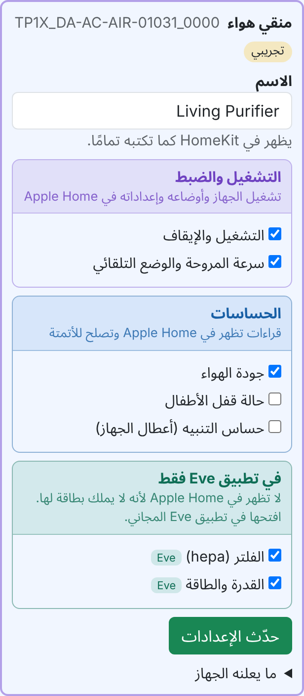</p>

عنوان IP وحده **لا يكفي** لجميع الأجهزة. يُعدّ الاكتشاف ناجحًا بعد قراءة هوية الجهاز وموارده فعليًا عبر جلسة مصادَق عليها.

## المتطلبات

| المتطلب | التفاصيل |
|---|---|
| Homebridge | 2.x (اختُبر على 2.5). يُتوقع أن يعمل على 1.8 فأحدث دون اختبار |
| Node.js | 22.12 فأحدث، أو 24 |
| محرك الاتصال | تختاره من إعدادات الإضافة. **JavaScript** يعمل مباشرة بعد التثبيت دون أي تجهيز. **Python** يتطلب Python **3.11 أو أحدث** مع `venv` و `pip` |
| المعالج | ARM 64-بت (Raspberry Pi 4 أو 5 بنظام 64-بت) أو x86-64. **الأنظمة 32-بت غير مدعومة** |
| الشبكة | يجب أن يصل جهاز Homebridge إلى الأجهزة مباشرة. في Docker استخدم `network_mode: host` |

بقية هذا القسم تخص محرك Python فقط. **صورة Homebridge الرسمية على Docker (المبنية على Ubuntu 24.04) تتضمن Python 3.12 و pip و venv مسبقًا**، فلا يلزم تجهيز إضافي. النسخة الأقدم المبنية على Ubuntu 22.04 تتضمن Python 3.10، وهو أقدم من المطلوب.

عند أول تشغيل تنشئ الإضافة بيئة Python خاصة بها في `samsung-local/venv` داخل مجلد تخزين Homebridge، وتنزّل إليها حزمًا محددة الإصدار (نحو 32 ميغابايت). تعمل بصلاحيات مستخدم Homebridge دون صلاحيات المدير، ولا تثبّت شيئًا على مستوى النظام، ولا تثبّت شيئًا أثناء `npm install`.

### الاتصالات الخارجية

| متى | إلى أين | السبب |
|---|---|---|
| محرك Python فقط: أول تشغيل، وبعد تحديث يغيّر إصدارات الحزم | `pypi.org` و `files.pythonhosted.org` | تنزيل حزم Python المحددة. محرك JavaScript لا ينزّل شيئًا |
| التشغيل المعتاد | لا يوجد اتصال خارجي | يُتصل بالأجهزة داخل الشبكة المحلية فقط |
| ضغطتَ **مسح الشبكة** في الإعدادات | كل عناوين شبكة المنزل (نطاق /24) وعنوان مجموعة OCF `224.0.1.187`: المنفذ UDP 5683 للأجهزة و TCP 8001 للتلفزيونات، ثم قراءة واحدة لكل جهاز جديد | عند ضغط الزر فقط، ولا يعمل المسح في الخلفية. لا يُضاف ولا يُحفظ شيء قبل تأكيدك، ولا يخرج شيء من شبكتك. |
| توقف جهاز عن الإجابة (اختياري، مفعّل افتراضيًا) | كل عناوين شبكة المنزل التي كان عليها (نطاق /24)، المنفذ UDP 5683 | سؤال صغير واحد للعثور على الجهاز في عنوانه الجديد، مرة كل خمس دقائق على الأكثر. لا يخرج شيء من شبكتك. يُوقف من «عام» ← «ابحث عن الجهاز من جديد إذا تغيّر عنوانه» |
| تلفزيونات Samsung | التلفزيون نفسه، المنفذان TCP 8001 و 8002، وحزمة إيقاظ واحدة عبر الشبكة لتشغيله | قناة التحكم المحلية الخاصة بالتلفزيون |
| اختياري: ضغطتَ **استورد وابحث في الشبكة** في «الأسماء من SmartThings» | `api.smartthings.com` عبر HTTPS، للقراءة فقط | أسماء أجهزتك وغرفها، مرة واحدة، بالرمز الذي لصقته. عند ضغط الزر فقط، ولا يُحفظ الرمز |

تُنشأ شهادة العميل على جهازك. يبقى مفتاحها الخاص محليًا بصلاحيات `0600` داخل `samsung-local/credentials`، ولا يظهر في السجل أو التشخيص.

## التثبيت

ابحث عن **Samsung Local** في تبويب **Plugins** داخل Homebridge ثم ثبّتها.

أو نفّذ في طرفية Homebridge:

<div dir="ltr">

```sh
cd /var/lib/homebridge
npm install --save homebridge-samsung-local
```

</div>

ثم أعد تشغيل Homebridge.

## الإعداد

1. افتح إعدادات الإضافة واختر محرك الاتصال. يعمل JavaScript مباشرة. ومع Python اضغط **جهّزها الآن** إذا لم تكن بيئته جاهزة.
2. أضف أجهزتك بإحدى طريقتين:
   - **مسح تلقائي:** اضغط **مسح الشبكة**. تبحث الإضافة مرة واحدة في شبكة المنزل، وتتعرّف على كل جهاز تجده، ثم تعرضها في قائمة. حدّد ما تريد واضغط **إضافة المحدد**. التلفزيون يطلب موافقة واحدة على شاشته أولًا. الأجهزة المضافة مسبقًا تظهر بوصفها مضافة وتبقى كما هي.
   - **يدويًا:** أدخل عنوان IP للجهاز، أو عنوان MAC، واضغط **اختبار واكتشاف**.
3. في الإضافة اليدوية، تحت حقل العنوان مباشرة: سمِّه إن أردت، وحدّد ما يظهر في HomeKit. وتحت ذلك جدول الوظائف التي يعلنها الجهاز.
4. اضغط **أضف إلى الإعدادات**.
   التلفزيون يحتاج خطوة قبلها: اضغط **اقتران مع التلفزيون** واختر «سماح» على شاشته.
5. من بطاقة الإضافة افتح **⋮ ← إعدادات الجسر** وفعّل **الجسر الفرعي**. أعد التشغيل، ثم امسح رمز QR الخاص بالجسر الفرعي من تطبيق Home.

تعرض صفحة الإعدادات هذه الخطوات وبجانب كل خطوة مكتملة علامة، مع رقم الإصدار والمحرك المستخدم وعدد الأجهزة المتصلة.

<p>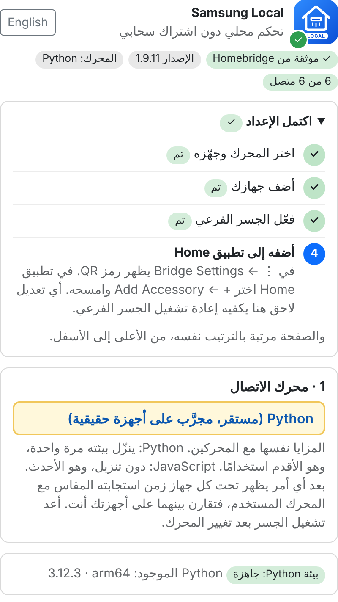</p>

### المسح التلقائي

مجرَّب على شبكة منزل حقيقية: أجابت خمسة مكيفات وغسالة وتلفزيون في مسح واحد.

**البداية.** بطاقة «إضافة جهاز» تعرض الطريقتين. زر **مسح الشبكة** يبحث مرة واحدة لنحو 15 ثانية.

<p>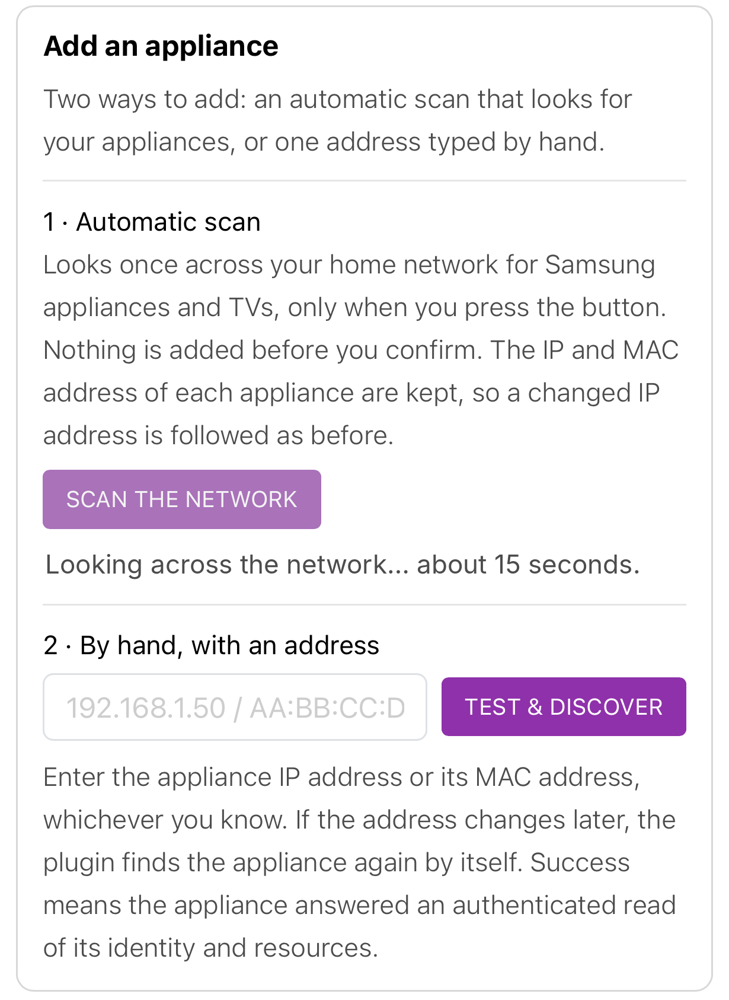</p>

**النتيجة.** يظهر كل جهاز أجاب مع عنوانه. الأجهزة الموجودة في قائمتك تظهر «مضاف مسبقًا» وتبقى كما هي. والسطر أعلى القائمة يبيّن عدد العناوين العاملة على الشبكة وكم منها أجاب كجهاز أو تلفزيون.

<p>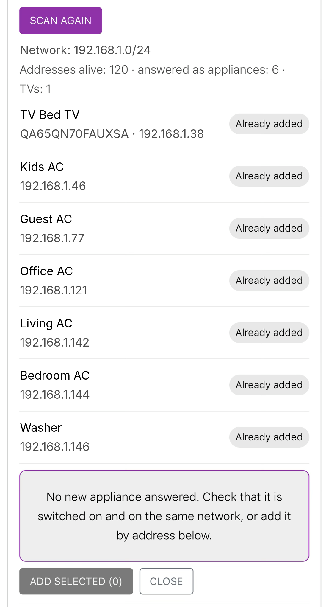</p>

**جهاز جديد.** الجهاز الجديد يُقرأ ويظهر بنوعه وموديله ومحدَّدًا بحالة «جاهز للإضافة». اضغط **إضافة المحدد**؛ ثم تجد اسمه وخياراته تحت صفه في القائمة. (الصف الأخير مثال مضاف إلى الصورة السابقة.)

<p>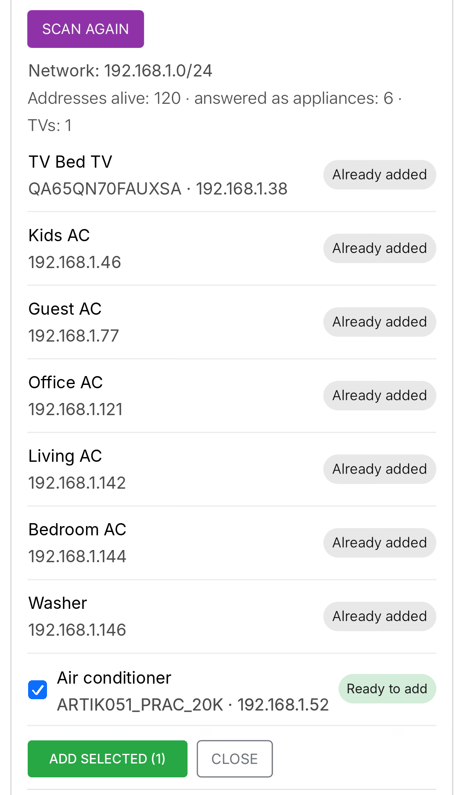</p>

تشغيل الإضافة كجسر فرعي يمنحها اقترانًا مستقلًا برمز QR خاص وملفات كاش خاصة. تُسمّى الأجهزة كما تكتبها تمامًا، فاختر أسماء تختلف عن أسماء أجهزة الإضافة الحالية. ظهور الجهاز نفسه مرتين (مرة من كل جسر) أثناء التجربة أمر متوقع.

### الأسماء من SmartThings (اختياري)

هدفه تسمية أجهزتك ومطابقتها بما يجده البحث في الشبكة، مرة واحدة فقط. إذا كنت سمّيت أجهزة كثيرة في SmartThings، تنتقل أسماؤها وغرفها فلا تحتاج أن تكتبها من جديد. لا تتحكم الإضافة بأي جهاز عن طريق SmartThings، ولا تتصل به مرة أخرى بعد الاستيراد. ولا تحتاجه لاستعمال الإضافة.

تجده شريطًا مستقلًا في «إضافة جهاز»، مطويًا حتى تفتحه:

<p></p>

1. اضغط الزر الذي تحت الخطوة 1. على iPhone و iPad اسمه **افتح صفحة الرموز في Safari**: يُسلَّم العنوان إلى النظام، فيفتح `account.smartthings.com/tokens` في Safari كأنه مكتوب. وعلى بقية الأجهزة، أو إذا لم يأخذه النظام، اسمه **افتح شرح SmartThings**: يفتح شرح SmartThings الرسمي للرموز الشخصية، وتضغط فيه رابطه `account.smartthings.com/tokens`. سجّل الدخول بحساب Samsung إذا طلب، ثم اضغط **Generate new token**.
2. في النموذج اكتب أي اسم للرمز، واختر صلاحيات القراءة فقط: **List all devices** و **See all devices**، ولأسماء الغرف والمواقع **See all locations** (اختياري).
3. أنشئ الرمز وانسخه، ثم الصقه في الإعدادات واضغط **استورد وابحث في الشبكة**.

إذا وصلت إلى صفحة الرموز برابط فقد تنتهي بصفحة خطأ Samsung (403) حين يكون المتصفح داخلًا إلى Samsung من قبل، والعنوان نفسه يفتح إذا لُصق في تبويب جديد. هذا من جهة Samsung ولا تستطيع الإضافة تغييره، فالمساعدة تحت الزر تُبقي العنوان المباشر رابطًا، ومعه زر نسخ.

يُستعمل الرمز مرة واحدة لهذه القراءة ثم يُنسى: لا يُحفظ في ملف، ولا يظهر في السجل. ينتهي من نفسه بعد 24 ساعة، ويمكنك حذفه من الصفحة نفسها بعد الاستيراد.

<p>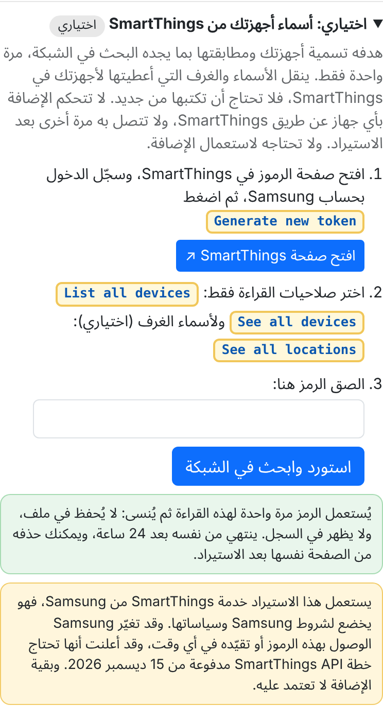</p>

والذي يُحفظ هو القائمة نفسها (الأسماء والغرف والموديلات والمعرّفات)، في مجلد الإضافة على Homebridge عندك، ولا تُرسل إلى أي مكان: أي بحث لاحق يطابق بها، فالجهاز الذي كان مطفأً يظهر لاحقًا دون اتصال جديد بـ SmartThings. وإذا استوردت مرة أخرى تُدمج القائمة الجديدة مع المحفوظة. و«تجاهل الاستيراد» يحذفها، وكذلك «حذف بيانات هذه الإضافة».

**شريط يبيّن أين وصل العمل**، في أربع مراحل: الاتصال بـ SmartThings، ثم الاستيراد، ثم مسح الشبكة، ثم المطابقة. والبحث اللاحق يجري على الشبكة فقط.

<p>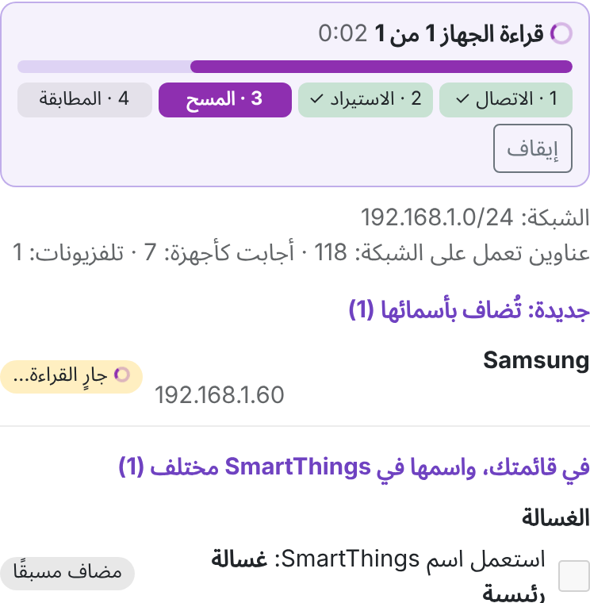</p>

**النتيجة تبقى في الصفحة.** البحث الجديد يضيف إليها ولا يمسحها: ما وُجد يبقى بمطابقته حتى لو لم يرد في المرة التالية، وما يوجد الآن عليه علامة «وُجد الآن». والصفوف مجموعة بحسب ما تقرره:

- **جديدة: تُضاف بأسمائها.** محددة، ومعها الاسم والغرفة من SmartThings وطريقة المطابقة: بمعرّف الجهاز نفسه (جُرّب في بيت حقيقي على خمسة مكيفات وغسالة)، أو بالموديل، أو باختيارك من الأسماء الباقية.
- **في قائمتك، واسمها في SmartThings مختلف.** حدد «استعمل اسم SmartThings» لما تريده منها، وما تتركه يبقى باسمك.
- **في قائمتك: لم يتغير شيء.** مطوية.
- **في SmartThings فقط: لم يرد.** زر **ابحث عنه** يبحث عن هذا الجهاز وحده حتى ثلاث محاولات، ويتوقف حين يجده. وزر **راقب حتى تظهر** يواصل البحث دقائق: شغّل الجهاز وسيظهر وحده. ومعه ما تتحقق منه (الكهرباء، وشبكة Wi-Fi البيت نفسها، والتلفزيون في وضع الاستعداد). وزر **تجاهله** يُبعد جهازًا ليس في هذا البيت، مثل شاشة في المكتب: يُحفظ اختيارك، وإذا رد يومًا على هذه الشبكة يظهر مثل أي جهاز آخر. والجهاز المتجاهَل، أو الذي في موقع آخر في SmartThings، يطابق بمعرّفه فقط: فجهاز ثانٍ من الموديل نفسه في البيت لا يأخذ اسمه.
- الأجهزة التي في موقع آخر في SmartThings، مثل المكتب، والتي تعمل عبر السحابة فقط (الحساسات والمراكز) مطوية، كل مجموعة في سطر.

وشريط واحد تحت القائمة للقرار: **طبّق المحدد**، و**حدد الكل**، و**ألغِ الكل**.

<p>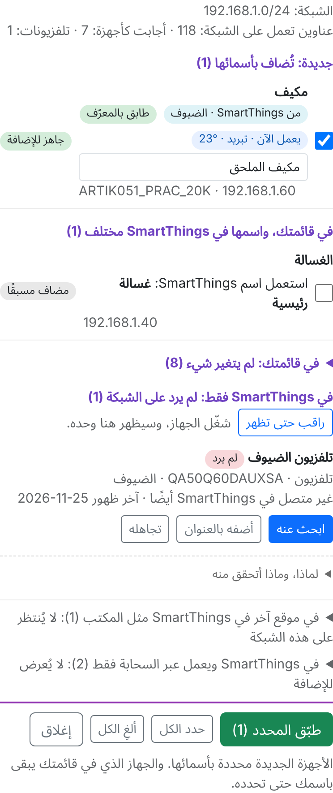</p>

**البحث عن جهاز واحد.** اضغط **ابحث عنه** في صفه: يظهر شريط صغير بالمحاولات في هذا الصف وحده، ومعه «إيقاف»، وكل ما عداه يبقى في مكانه.

<p>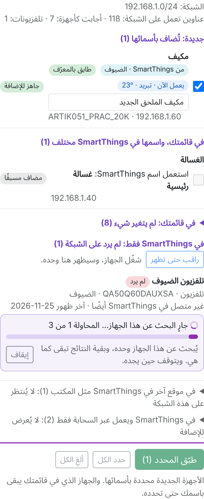</p>

الاسم القادم من SmartThings اسم أعطيته أنت، فيُحفظ مثل الاسم الذي تكتبه.

**يخضع لسياسات Samsung.** يستعمل هذا الاستيراد خدمة SmartThings من Samsung، فهو يخضع لشروط Samsung وسياساتها. وقد تغيّر Samsung الوصول بهذه الرموز أو تقيّده في أي وقت، وقد أعلنت أنها تحتاج خطة SmartThings API مدفوعة من 15 ديسمبر 2026. وبقية الإضافة لا تعتمد عليه.

يُفضَّل تثبيت عنوان كل جهاز من الراوتر. المكيف أو الغسالة إذا تغيّر عنوانه تجده الإضافة من جديد. ولتحديد العنوان بنفسك اضغط **تغيير العنوان** بجانب الجهاز، وأدخل الجديد، ثم اضغط **اختبار واكتشاف**: يُحدَّث الإدخال الموجود نفسه.

### أجهزتك في الإعدادات

تعرض الإعدادات أجهزتك مصنّفة حسب النوع: المكيفات، الغسيل، التلفزيونات، والأنواع الأحدث. كل جهاز سطر واحد فيه اسمه وحالته، والسهم في طرف السطر وحده يفتحه، فلن يضغط الإصبع شيئًا بالغلط وهو يمرّر الصفحة. وتُطوى المجموعة من عنوانها.

<p>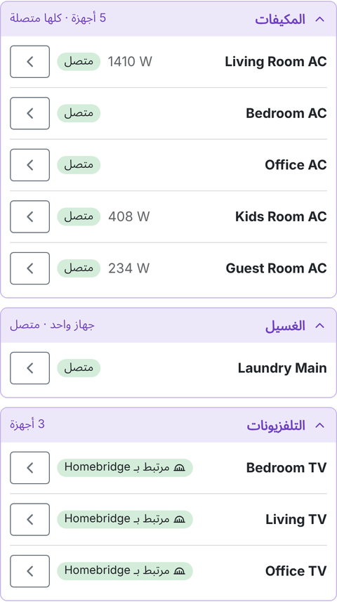</p>

البطاقة المفتوحة فيها كل ما يخص الجهاز: اسمه ومعه قلم لتعديله في مكانه، العنوان، الطاقة، الخيارات، تغيير العنوان، التشخيص، التفعيل، والحذف الذي يطلب ضغطتين. أي تغيير داخل الخيارات يبقى دون حفظ حتى تضغط «حفظ» أو «تحديث»، وإلى ذلك الحين يظهر شريط في الأسفل يقول ذلك، ومعه «تراجع».

<p>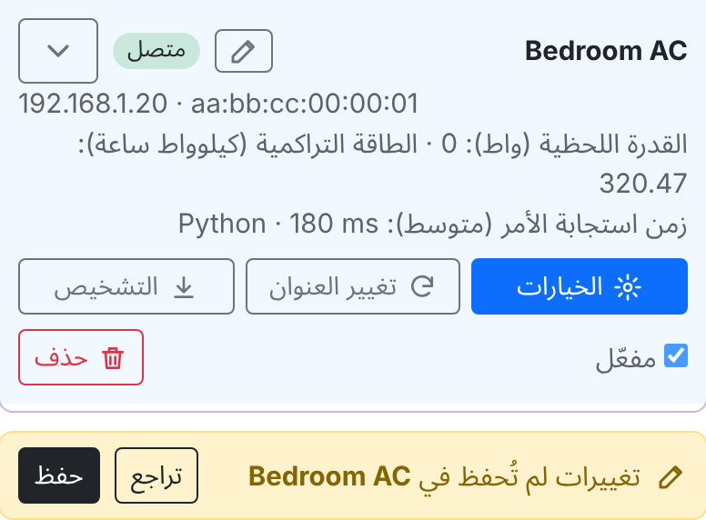</p>

### الاختبار بوجود LocalThings

قد يقبل الجهاز اتصالًا محليًا واحدًا في الوقت نفسه. إذا كان LocalThings أو تكامل محلي آخر متصلًا بالجهاز فقد تنتهي مهلة الاكتشاف أو يتكرر انقطاع الطرفين. لاختبار نظيف عطّل إدخال ذلك الجهاز في LocalThings أولًا ثم اكتشفه هنا. هذه الإضافة لا توقف أي تكامل آخر ولا تغيّر شيئًا في SmartThings.

أبقِ الأجهزة مسجّلة في تطبيق SmartThings: حذف الجهاز منه يعيد ضبط إعدادات شبكته.

## الظهور في Apple Home

جهاز واحد لكل مكيف يضم الخدمات التالية. تظهر الخدمة عند إعلان الجهاز عن الوظيفة فقط، ويمكن إخفاء كل خدمة لكل جهاز.

| الوظيفة أو القياس | خدمة HomeKit | مكان الظهور | القيود |
|---|---|---|---|
| التشغيل، تبريد / تدفئة / تلقائي، الحرارة المستهدفة والحالية | منظم الحرارة | Apple Home | بالسيلسيوس. المدى والخطوة من الجهاز نفسه |
| تجفيف، Purify (مروحة فقط) | مفتاحان | Apple Home | منظم الحرارة في HomeKit يخلو من هذين الوضعين. Purify هو وضع المروحة فقط في المكيف، باسمه في SmartThings |
| سرعة المروحة: منخفض / متوسط / مرتفع / القصوى | شريط المروحة (4 درجات) | Apple Home | |
| المروحة **التلقائية** | مفتاح مستقل، وخيار «تلقائي» في المروحة، والقيمة 0% على الشريط | Apple Home | يعرض الشريط الوضع التلقائي بالقيمة 0% |
| السرعة **القصوى** (Turbo) | مفتاح مستقل، وأعلى درجة في الشريط | Apple Home | |
| التأرجح | تأرجح المروحة | Apple Home | تشغيل وإيقاف فقط؛ HomeKit يخلو من اختيار رأسي أو أفقي |
| WindFree وسريع وهادئ (واختياريًا: نوم، ذكي، راحة، مرحلتان، توجيه الهواء نحو الأشخاص أو إبعاده عنهم) | مفاتيح | Apple Home | وضع راحة واحد في الوقت نفسه، كما في الجهاز |
| إضاءة الشاشة | مصباح | Apple Home | تشغيل وإطفاء فقط. السطوع غير متاح محليًا |
| الرطوبة | حساس رطوبة | Apple Home | يُخفى ما دام الجهاز يُرجع صفرًا |
| الفلتر | صيانة الفلتر | Eve وتطبيقات HomeKit الأخرى | مؤشر الحاجة للتنظيف والعمر المتبقي. تطبيق Home من Apple لا يعرض هذا النوع |
| تنبيه تنظيف الفلتر (اختياري، غير مفعّل افتراضيًا) | حساس وجود | Apple Home | يتفعّل ما دام الفلتر يحتاج تنظيفًا: إشعار ومشغّل للأتمتة. ويرجع بعد تنظيف الفلتر وتصفير عدّاده. يسمّي Apple Home حالته «مُكتشف»، وقد يحسبه ضمن وجود أشخاص في الغرفة، وهو لا علاقة له بالأشخاص، فلا تضعه في أتمتة مبنية على وجودهم |
| صوت التنبيه، التنظيف التلقائي | مفتاحان (معطّلان افتراضيًا) | Apple Home | |
| القدرة اللحظية (واط) والطاقة التراكمية (كيلوواط ساعة) | خصائص Eve على منظم الحرارة | التطبيقات المتوافقة مع Eve وصفحة إعدادات الإضافة | Apple Home يخلو من نوع للقدرة أو الطاقة، ولم يُستخدم نوع حساس مضلل |
| التنبيهات ورموز الأعطال | — | صفحة إعدادات الإضافة والسجل | |
| الجهد والتيار | — | — | لم تعلن عنهما المكيفات المسجّلة |
| الحركة والإشغال | — | — | لم يُعرف مورد محلي يحمل نتيجة الاستشعار |
| بقية ما يعلنه الجهاز | — | ملف التشخيص | منقّح، ليُدعم لاحقًا |

قواعد السلوك:

- **إطفاء** مفتاح WindFree أو سريع أو هادئ يبقي المكيف يعمل، وإطفاء وضع غير نشط لا يرسل أي أمر.
- بطاقة المروحة لا تطفئ المكيف (يرسل HomeKit أمر الإيقاف عند سحب الشريط إلى الصفر).
- يُعدّ الأمر ناجحًا بعد تأكيد الجهاز استلامه. الأمر المرفوض يظهر فاشلًا. إذا أكد الجهاز الاستلام ثم لم يطبّق التغيير فيعود HomeKit إلى الحالة الحقيقية خلال ثوانٍ.
- بعض المكيفات تجيب أحيانًا على أمر صحيح بالرفض (4.00). تعيد الإضافة الأمر مرة واحدة، ويذكر السجل متى حدث ذلك وكيف انتهى.
- الإطفاء من Apple Home يظهر على كل بطاقات المكيف دفعة واحدة.
- أمر واحد وصوت واحد: يُرسل التغيير الفعلي فقط. التشغيل على الوضع الذي تُرك عليه المكيف يرسل أمر التشغيل وحده، والطلب الواحد الذي يصل من عدة بطاقات يُرسل مرة واحدة، والقيمة الموجودة أصلًا في الجهاز لا تُرسل من جديد.
- التغييرات من الريموت أو تطبيق Samsung تنعكس في HomeKit.
- عند تعذر الوصول إلى الجهاز يظهر **لا يستجيب** ويبقى الجهاز في HomeKit. يُحذف الجهاز عند حذفه من إعدادات الإضافة فقط.

الفروق عن `homebridge-smartthings-oauth`: فكرة الترتيب واحدة (منظم حرارة ومروحة ومفاتيح أوضاع ومصباح وحساس رطوبة). إضاءة الشاشة هنا دون سطوع.

### المكيف في Apple Home

الترموستات: الحرارة المطلوبة والحالية والرطوبة والوضع.

<p>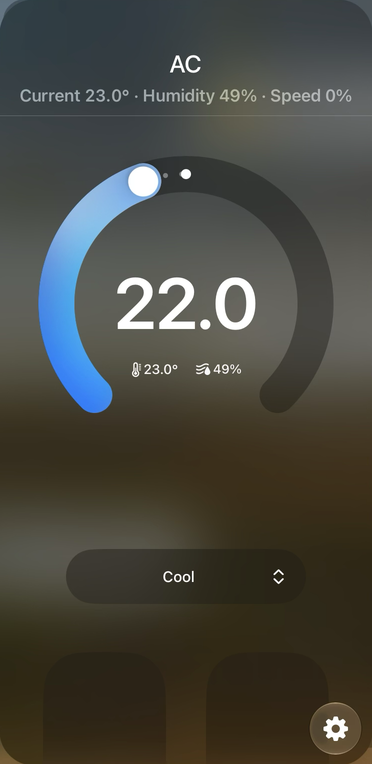</p>

أجزاء المكيف نفسه. كل جزء منها يمكن إيقافه من إعدادات الإضافة.

<p>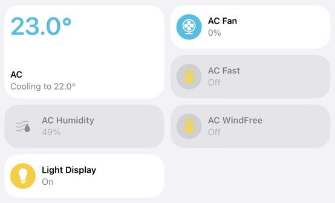</p>

### الغسالة في Apple Home

بطاقة الدورة تعمل أثناء الغسيل ويظهر داخلها الوقت المتبقي. والحساس يتفعّل عند انتهاء الدورة ليُبنى عليه إشعار أو أتمتة. في الغسالة التي تعلن نهاية الدورة بنفسها يتفعّل الحساس بهذا الإعلان فقط، فالدورة الملغاة لا تعطي إشعارًا. الغسالة للقراءة فقط، ولا يُرسل إليها أي أمر إلا إذا اخترت تحكمًا تجريبيًا (في الأسفل).

تجريبي: لكل مرحلة تعلنها الغسالة (غسيل، شطف، عصر) حساس يتفعّل وقت تلك المرحلة فقط، ليُبنى عليه أتمتة مثل إشعار عند بدء العصر. ولتنظيف الحوض حساس خاص، لأن الغسالة العلوية تعلنه مرحلة قائمة بذاتها. تطبيق Home لا يعرض نصًا حرًا على البطاقة، لذلك تظهر الدورة نفسها (باسمها إن كان معروفًا، وإلا برقمها) وتاريخ آخر تنظيف للحوض في إعدادات الإضافة وفي السجل. ويمكن إطفاء كل واحد منها من الإعدادات.

<p>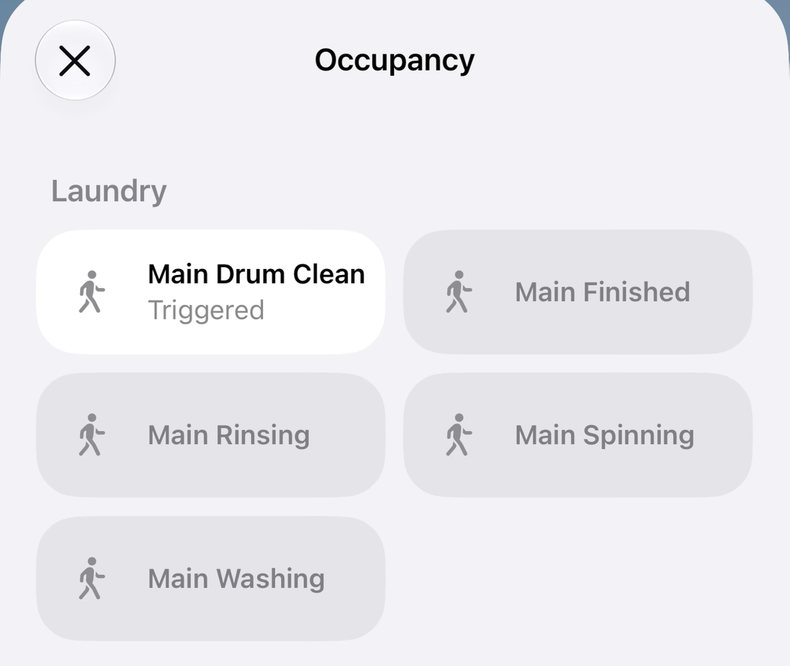</p>

<p>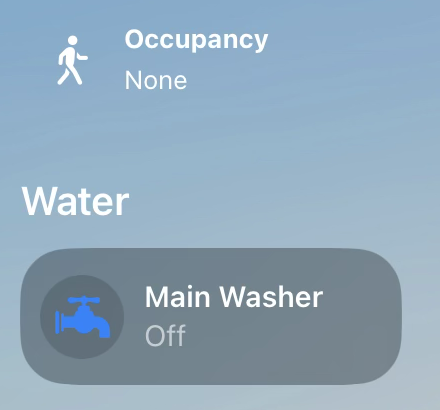</p>

### تلفزيون Samsung في Apple Home

يظهر التلفزيون بطاقةً لها زر تشغيل وقائمة مداخل.

<p>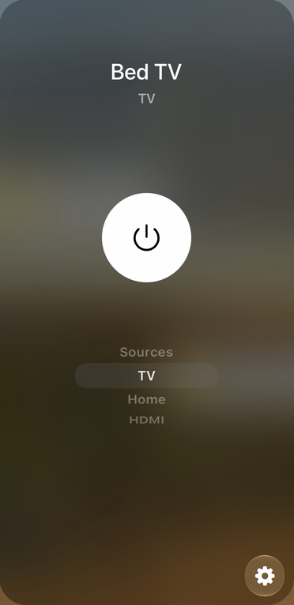</p>

الريموت في مركز التحكم: افتح الريموت واختر التلفزيون من الأعلى. رفع الصوت وخفضه بأزرار الآيفون أو الآيباد الجانبية والريموت مفتوح.

<p>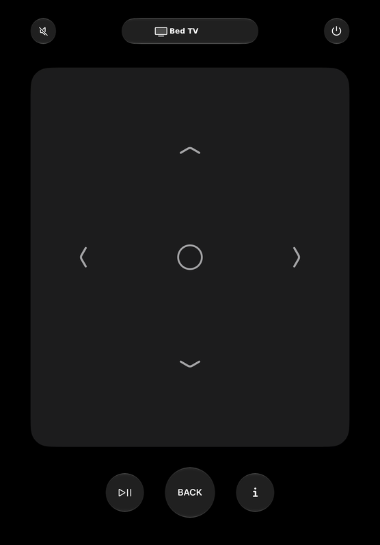</p>

**ريموت مثل Apple TV (تجريبي).** بدل البطاقة أو معها، يمكن أن يظهر التلفزيون في ريموت مركز التحكم نفسه كما يظهر Apple TV: بمنطقة لمس وبلوحة مفاتيح الآيفون، وتُفتح حين يفتح التلفزيون أحد حقول الكتابة الخاصة به (بحث التلفزيون، الإعدادات، المتصفح). يُختار من قائمة الريموت ويُقرن مرة واحدة على كل آيفون أو آيباد أو Apple Watch برمز من أربعة أرقام (0000 ما لم تختر رمزك). حدوده: التطبيقات التي لها لوحة مفاتيح خاصة مثل YouTube و Netflix لا تقبل الكتابة منه؛ وفتح الريموت لا ينجح دائمًا من أول مرة، بصورتين مختلفتين: الأكثر رمش يتعافى من نفسه خلال ثانية إلى خمس ثوانٍ، وأحيانًا يعرض الجوال «Can't Connect» ويرجع إلى القائمة، واختيار التلفزيون مرة أخرى يفتحه؛ وهو غير رسمي وقد يتوقف بعد تحديث iOS. ولا يخرج من شبكتك.

<p>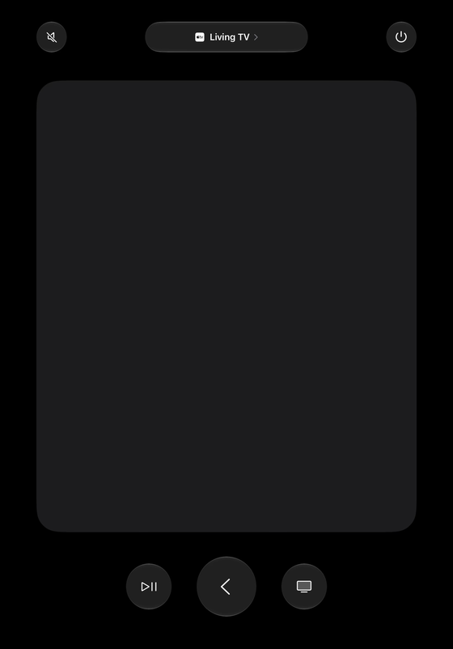</p>

**مساحة اللمس: سحب مثل Apple TV، أو مؤشر مثل الماوس (تجريبي، جُرِّب على تلفزيونين حديثين).** «سحب مثل Apple TV» هو الافتراضي ويعمل على كل التلفزيونات: السحب يحرّك التحديد خطوة خطوة. و«مؤشر مثل الماوس» يحرّك مؤشرًا على الشاشة، وهو للتلفزيونات الحديثة فقط: تلفزيونات Samsung القديمة (ومنها موديلات 2016) لا تُظهر مؤشرًا، فيظهر لها الخيار باهتًا مع تنبيه، بحسب ما يعلنه التلفزيون نفسه. المؤشر يظهر في متصفح التلفزيون وبعض التطبيقات، وفي غيرها لن يتحرك شيء. اللمسة بعد تحريك المؤشر تضغط ما تحته، وإذا بقي المؤشر ساكنًا 8 ثوانٍ تعود اللمسة «اختيار».

**مفاتيح للأتمتة (اختياري).** التشغيل، كتم الصوت، رفع الصوت وخفضه، القناة التالية والسابقة، تشغيل/إيقاف مؤقت، والصفحة الرئيسية: كل منها يمكن أن يظهر مفتاحًا، وكلها مجموعة تحت ملحق واحد في الجسر، للأتمتة والمشاهد. وتعمل مع أي اختيار للريموت.

تشترط Apple إضافة كل بطاقة تلفزيون بمفردها. بعد إضافة التلفزيون في إعدادات الإضافة يظهر رمزه بجانبه في قائمة الأجهزة المضافة (راجع [خيارات التلفزيون](#خيارات-التلفزيون) بالأسفل).

ثبّت لكل تلفزيون عنوانًا في الراوتر (حجز DHCP). المكيف أو الغسالة إذا تغيّر عنوانه تجده الإضافة من جديد، أما التلفزيون فلا تتابعه، لأن التلفزيون المطفأ لا يجيب أصلًا فلا يتميز عن تلفزيون تغيّر عنوانه. إذا تغيّر عنوان تلفزيون فاضغط **تغيير العنوان** بجانبه.

## خيارات كل جهاز

لكل جهاز خياراته. اضغط **الخيارات** تحته في إعدادات الإضافة: تُفتح في مكانها، تحت الجهاز نفسه. حدّد ما تريد ظهوره في Apple Home، ثم اضغط **حدّث الإعدادات**. الخيارات في ثلاث بطاقات على الأكثر، بهذا الترتيب دائمًا: **التشغيل والضبط** (التشغيل والأوضاع والإعدادات)، ثم **الحساسات** (القراءات)، ثم **في تطبيق Eve فقط**. تُعرض فقط الوظائف التي يعلنها جهازك. الجزء الذي تُطفئه يُزال من Apple Home، ويبقى الباقي كما هو.

يُغيَّر الاسم في مكانه بالقلم الذي بجانبه. وزر **حذف** يطلب ضغطتين.

### خيارات المكيف

بطاقة المروحة، مفاتيح الأوضاع، WindFree، Fast، Quiet، إضاءة الشاشة، الرطوبة، تنبيه تنظيف الفلتر، الحرارة الخارجية، الفلتر، القدرة والطاقة.

الفلتر، والقدرة والطاقة، تظهر في تطبيق **Eve** المجاني وتطبيقات HomeKit الأخرى، ولا تظهر في Apple Home لأنه لا يملك بطاقة لها. وتضعها الإعدادات في بطاقة خاصة بها، «في تطبيق Eve فقط»، وعلى كل منها شارة Eve، حتى لا يُظن أن الجزء الذي لا يظهر في Apple Home عطل.

<p>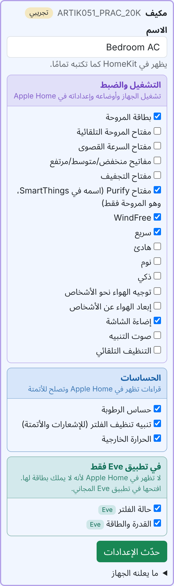</p>

### خيارات الغسالة

في ثلاث بطاقات كبقية الأجهزة. بطاقة **التحكم (تجريبي)** موضّحة في قسم التحكم بالغسالة أدناه. **الحساسات**: بطاقة الدورة مع الوقت المتبقي، حساس انتهاء الدورة، حساسات المراحل، تنظيف الحوض، نسبة التقدم، حالة قفل الأطفال، تنبيه الأعطال، تذكير إخراج الغسيل، Smart Control، وطريقة عمل بطاقة الدورة عند الضغط عليها. **في تطبيق Eve فقط**: القدرة والطاقة.

<p>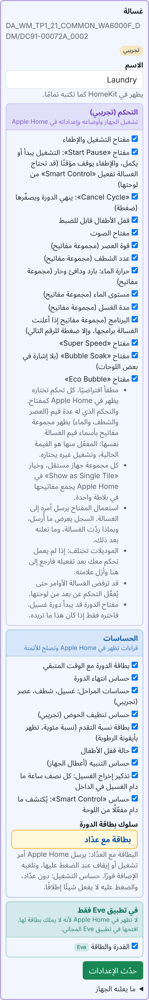</p>

#### التحكم بالغسالة (تجريبي)

**جُرِّب على غسالة واحدة، علوية من موديل WA80F16B9CYL.** عليها، و«Smart Control» مطفأ من لوحتها: التشغيل والإطفاء، إلغاء الدورة، قفل الأطفال، الصوت، البرنامج، قوة العصر، عدد الشطف، حرارة الماء، مستوى الماء، مدة الغسل، «Super Speed» و«Eco Bubble» ضُبطت كلها من Apple Home. والبدء والإيقاف المؤقت عملا فقط و«Smart Control» مفعّل من اللوحة. قد تختلف الموديلات الأخرى، ولهذا يبقى تجريبيًا. كل تحكم مطفأ حتى تختاره.

| التحكم | في Apple Home | ما يُرسل |
|---|---|---|
| التشغيل والإطفاء | مفتاح | تشغيل أو إطفاء |
| «Start Pause» | مفتاح | التشغيل: بدء أو إكمال، والإطفاء: إيقاف مؤقت. قد تقبلهما الغسالة فقط و«Smart Control» مفعّل من لوحتها، والمفتاح يعرض حالة الدورة في الحالتين |
| «Cancel Cycle» | ضغطة | إنهاء الدورة وتصفيرها، وبعكس الإيقاف المؤقت لا تُكمَل بعدها |
| قفل الأطفال | القفل يصبح قابلًا للضبط | قفل أو فتح |
| الصوت | مفتاح | تشغيل أصوات الغسالة أو إطفاؤها |
| حرارة الماء، قوة العصر، عدد الشطف، مستوى الماء، مدة الغسل | مجموعة مفاتيح لكل واحد، مفتاح لكل قيمة من قائمة الغسالة نفسها («Water Hot»، «Water Level 6»، «Rinse 2»)، والمفعّل منها هو القيمة الحالية | قيمة المفتاح الذي تشغّله، وتنطفئ البقية |
| البرنامج | مجموعة مفاتيح، مفتاح لكل برنامج تعلنه الغسالة، باسمه في اللوحة إذا عُرفت أسماء الموديل وإلا برقمه؛ وضغطة للرقم التالي إذا لم تعلن الغسالة قائمة | برنامج المفتاح الذي تشغّله |
| «Super Speed»، «Eco Bubble»، «Bubble Soak» | مفتاح لكل واحد، حيث تعلنه الغسالة | تشغيل تلك الإضافة أو إطفاؤها |

- كل مجموعة جهاز مستقل، فخيار «Show as Single Tile» في Apple Home يجمع مفاتيحها في بلاطة واحدة، ولكل مجموعة غرفتها.
- استعمال التحكم يرسل أمره، وإذا كان للأمر أكثر من صيغة محتملة تُجرَّب كل صيغة مرة واحدة بالترتيب.
- السجل يعرض ما أُرسل، وبماذا ردّت الغسالة، وما تعلنه بعد ذلك، في سطور تبدأ بـ `control trial`.
- الموديلات تختلف. إذا لم يعمل تحكم معك بعد تفعيله فارجع إلى الإعدادات وأزل علامته.
- قد ترفض الغسالة الأوامر حتى يُفعَّل التحكم عن بعد من لوحتها.
- مفتاح الدورة قد يبدأ دورة غسيل، فاختره فقط إذا كان هذا ما تريده.

<p>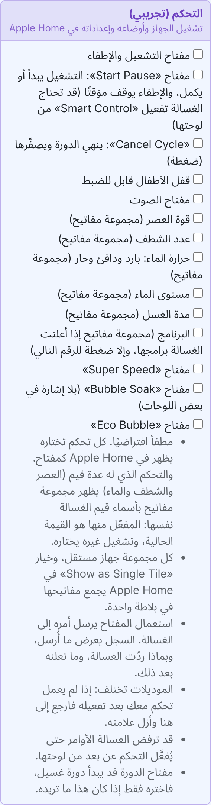</p>

على حد علمنا، هذه أول إضافة لـ Homebridge تضبط برنامج غسالة Samsung وعصرها وشطفها وحرارة مائها ومستواه ومدة الغسل والإضافات عبر الشبكة المحلية، دون السحابة. إذا عرفت إضافة أخرى فافتح بلاغًا ونصحح هذا السطر.

في Apple Home، على غسالة حقيقية علوية من موديل WA80F16B9CYL: كل إعداد مجموعة، والمجموعة تفتح على مفتاح لكل قيمة.

<p>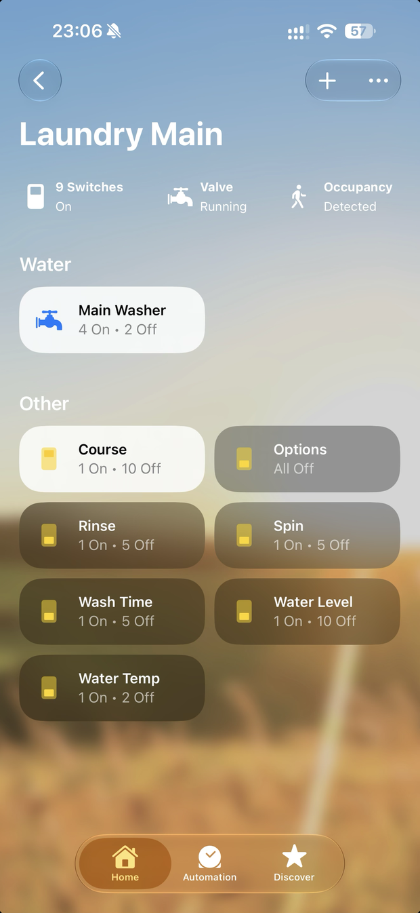 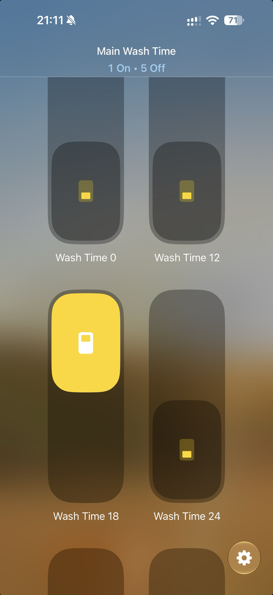</p>

### خيارات التلفزيون

خيارات التلفزيون ثلاث علامات لا يمنع أحدها الآخر: تختارها كلها أو بعضها أو لا شيء منها. وهي في مجموعتين.

1. **على الآيفون: ريموت مثل Apple TV (تجريبي)**، بالكيبورد ولوحة اللمس، داخل شبكة البيت فقط. وتحته رمز اقترانه وتعدّله في مكانه (الخانة الفارغة تعني 0000)، ومساحة اللمس: سحب مثل Apple TV أو مؤشر مثل الماوس.
2. **في تطبيق Home: بطاقة التلفزيون مع ريموت Home**، داخل البيت وخارجه (خارجه عبر المركز المنزلي: Apple TV أو HomePod أو HomeView). ورمزها لتطبيق Home تحتها مباشرة: **امسح الصورة** من تطبيق Home (+ ← Add Accessory) **أو اكتب الأرقام** (More options ثم اختر التلفزيون). وإن اخترت معها الريموت الذي مثل Apple TV، يصير للتلفزيون اسمان في قائمة الريموت، والثاني ينتهي بـ«+».
3. **في تطبيق Home: مفاتيح للأتمتة**. دون رمز: تأتي مع جسر هذه الإضافة. وتختار المفاتيح التي تظهر.


<p>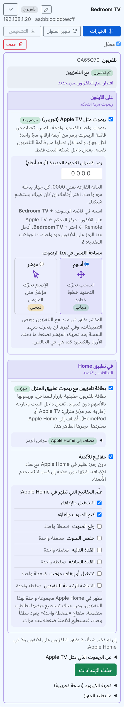</p>

عند اختيار ريموت مثل Apple TV، تُستعمل مساحة اللمس فيه إما «سحب مثل Apple TV» (مجرَّب، على كل التلفزيونات)، أو «مؤشر مثل الماوس» (تجريبي، للتلفزيونات الحديثة فقط، ويظهر باهتًا في الموديلات القديمة). المؤشر يظهر في متصفح التلفزيون وبعض التطبيقات.

<p>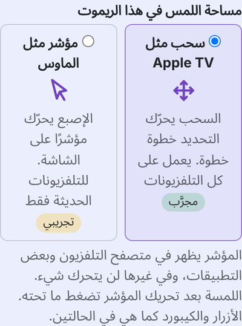</p>

## ما تم اختباره

| نوع الاختبار | الحالة |
|---|---|
| اختبارات وحدات ومحاكاة (159 بلغة JavaScript و25 بلغة Python): الاكتشاف، تحويل الحالات والأوامر، الوحدات، التلقائي والقصوى، تنافي أوضاع الراحة، التغيير من مصدر خارجي، إعادة الاتصال، إعادة التشغيل والجهاز غير متصل، تغيير العنوان، الاستقلال عن الإضافة الحالية، الحذف وإعادة التثبيت | **ناجحة** |
| تشغيل فعلي على Homebridge 2.5 كجسر فرعي على x86-64: تجهيز البيئة، بدء المساعد وإيقافه، إعادة المحاولة المتدرجة، ملفات اقتران وكاش مستقلة، بقاء ملفات الإضافات الأخرى دون تغيير | **ناجح** |
| تلفزيونات Samsung كبطاقة تلفزيون، على أربعة تلفزيونات مختلفة، حديثة وقديمة، أحدها لا يعمل مع SmartThings: الاقتران من شاشة التلفزيون، الإضافة إلى تطبيق Home، ريموت مركز التحكم (الأسهم، الرجوع، الكتم، الصوت بأزرار الجهاز الجانبية، المداخل) | **ناجح** (أربعة تلفزيونات: `UA55KU7000` و `QA50Q60D` و `QA65QN70F` و `QA75QN85D`) |
| الريموت الذي مثل Apple TV (تجريبي)، على تلفزيون واحد مع آيفون وآيباد و Apple Watch: الاقتران برمز الأرقام الأربعة، الأزرار، منطقة اللمس، الكتابة والحذف وقبول الاقتراحات في حقول الكتابة الخاصة بالتلفزيون | **يعمل، مع حدّ معروف**: نحو فتح واحد من كل ثلاثة يتأخر من ثانية إلى خمس ثوانٍ، وقد يعرض الجوال «Can't Connect» لحظة قبله |
| إضافة جهاز بعنوان MAC بدل عنوان IP على شبكة منزلية حقيقية: وجدت الإضافة العنوان بنفسها | **ناجح** |
| توفر حزم Python المحددة لمعالجات ARM64 (Python 3.11 و 3.12) | **تم التحقق** |
| التثبيت من بحث Plugins داخل حاوية Docker على Raspberry Pi (ARM64 و Python 3.12) | **ناجح** |
| الاكتشاف والقراءات الحيّة والتحديثات الفورية على مكيفات حقيقية | **ناجح** على خمس وحدات من فئتَي موديلات (`ARTIK051_PRAC_20K` و `TP1X_DA-AC-RAC-01001`) |
| التحكم من Apple Home (تشغيل، حرارة، مروحة، أوضاع) | **مؤكد على الوحدات الخمس كلها** |
| إعادة الاتصال على أجهزة حقيقية | **ناجحة**: الانقطاعات القصيرة تعود خلال ثوانٍ |
| غسالة (`WA80F16B9CYL`، من نوع `DA_WM_TP1_21_COMMON`) | **مؤكد على الغسالة الحقيقية**: حالة التشغيل ومرحلة الغسيل والوقت المتبقي وإشعار انتهاء الدورة. والتحكم مجرَّب عليها: البرنامج والعصر والشطف وحرارة الماء ومستواه ومدة الغسل وSuper Speed وEco Bubble والبدء والإيقاف المؤقت والإلغاء |
| المحركان على الأجهزة الستة نفسها (خمسة مكيفات والغسالة) | **ناجح**: كلاهما يتصل بالستة ويستقبل التحديثات الفورية. في مقارنة عند بدء التشغيل اتصل Python أسرع بنحو ثانية |
| أمر رُفض بالرمز 4.00 ثم أُعيد مرة واحدة | **مؤكد على مكيف حقيقي**: قُبل في المرة الثانية |

**النتيجة تعتمد على جهازك.** كل موديل يعلن مزاياه الخاصة. استخدم «اختبار واكتشاف» في الإعدادات: الجدول الظاهر هو ما يعلنه جهازك أنت، وهو ما يظهر في Apple Home.

## التشخيص

- من إعدادات الإضافة اضغط **التشخيص** لتنزيل ملف منقّح (دون أرقام تسلسلية أو عناوين MAC و IP أو معرّفات الأجهزة أو أسماء الشبكات والمفاتيح). التلفزيونات ليس لها ملف تشخيص.
- يكتب السجل كل 24 ساعة، لكل جهاز، عدد مرات فقد الاتصال وأطول انقطاع. إعادة تشغيل الجسر لا تُحتسب.
- الجهاز أو التلفزيون المفصول من الكهرباء ليس عطلًا: يذكر السجل مرة واحدة وبهدوء أنه لا يجيب، ويتصل من نفسه حين يعود إليه التيار.
- الشبكات الأخرى (VLAN): البحث يشمل الشبكات التي يعمل عليها Homebridge نفسه، وشبكة كل جهاز أو تلفزيون مضاف من قبل. والجهاز الذي على شبكة أخرى يُضاف بعنوان IP؛ وبعدها يشمل البحث تلك الشبكة أيضًا. و Apple Home والريموت الذي مثل Apple TV يجدان التلفزيون بإعلانات لا تعبر بين الشبكات إلا إذا كرّرها الراوتر (mDNS reflector).
- السجل اليومي قصير: سطر واحد حين يتصل جهاز أو ينقطع، وحين يُفتح الريموت أو لوحة مفاتيح التلفزيون ويُغلقان، ولكل ما هو غير متوقع.
- فعّل وضع Debug في Homebridge للتفاصيل: أزمنة الاتصال، وكل خطوة في ريموت الآيفون، والكتابة (الأطوال فقط دون النص). الشهادات والمفاتيح والنص المكتوب لا تُكتب في السجل.

## التحديث

من تبويب Plugins. تبقى الإعدادات والشهادة والأجهزة كما هي.

للرجوع إلى نسخة قبل 1.5.0: أزل أولًا علامة الريموت الذي مثل Apple TV من خيارات التلفزيون واضغط «تحديث»، ليُحذف ما خزّنه؛ ثم ثبّت النسخة الأقدم. والنسخ الأقدم لا تعرف مفاتيح الأتمتة، فتختفي من تطبيق Home إلى أن تحدّث من جديد.

## الإزالة

1. في تطبيق Home احذف **الجسر الفرعي** لهذه الإضافة (اضغط مطولًا على الجسر ثم «إزالة الجسر»). حذف حزمة الإضافة وحده **يُبقي** اقترانها في تطبيق Home. التلفزيون المضاف كبطاقة تلفزيون جهاز مستقل: احذف كل واحد منها من تطبيق Home أيضًا.
2. اختياريًا: من إعدادات الإضافة اضغط **احذف البيانات**. يُحذف مجلد `samsung-local` فقط (الشهادة والقراءات المحفوظة واقترانات التلفزيونات وبيئة Python).
3. ألغِ التثبيت من تبويب Plugins. عند توقف الإضافة يتوقف مساعدها معها، ولا تبقى عملية تعمل في الخلفية.

تبقى الإضافات الأخرى و Home Assistant وإعدادات شبكة الأجهزة وتسجيلها في SmartThings دون أي تغيير.

## الانتقال من الإضافة الحالية

راجع [docs/MIGRATION.md](docs/MIGRATION.md). أتمتة Apple Home **تحتاج نقلًا يدويًا**.

## الحقوق والتراخيص

ترخيص MIT. مبني على [SmartThings-Local](https://github.com/QuiteYellow/SmartThings-Local) (MIT، Jack Nagy) وخرائط الأجهزة في [LocalThings](https://github.com/mbillow/localthings) (MIT، Marc Billow). محرك JavaScript يستخدم طبقة النقل من [homebridge-samsung-ocf](https://github.com/aziz66/homebridge-samsung-ocf) (MIT). ترتيب خدمات HomeKit مستوحى من [homebridge-smartthings-oauth](https://github.com/aziz66/homebridge-smartthings) (Apache-2.0). التفاصيل في [THIRD_PARTY_NOTICES.md](THIRD_PARTY_NOTICES.md).

Samsung و SmartThings علامتان تجاريتان لشركة Samsung Electronics، وتُذكران هنا لتسمية الأجهزة التي يعمل معها البرنامج فقط.

</div>
