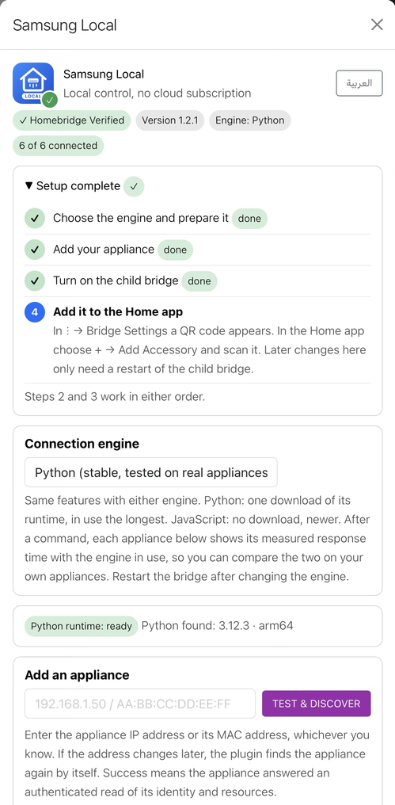
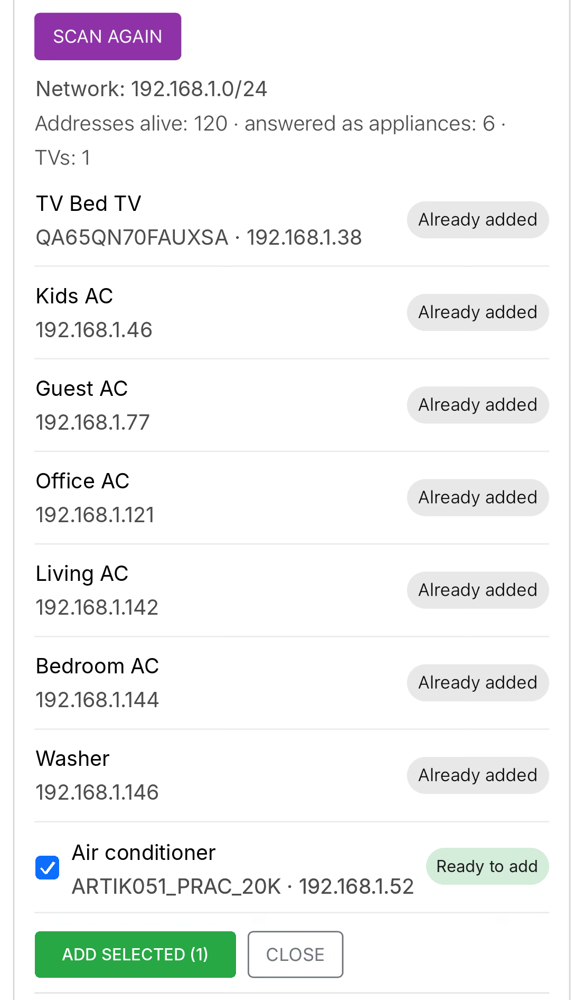
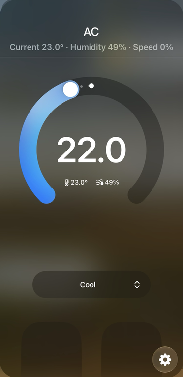
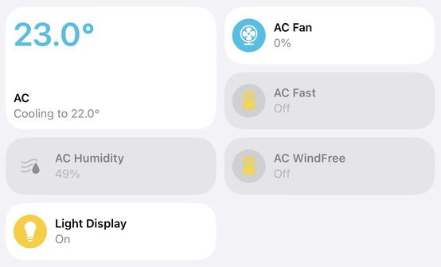
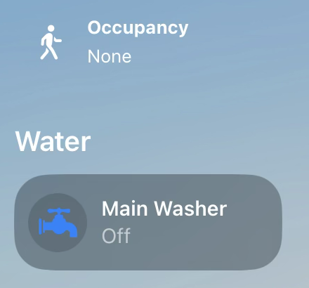
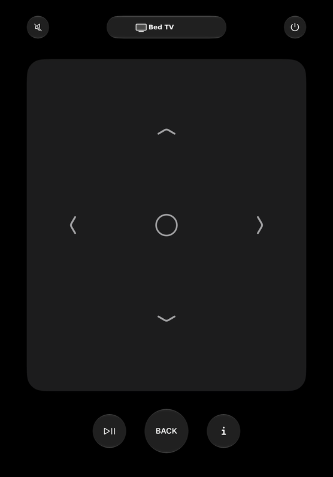
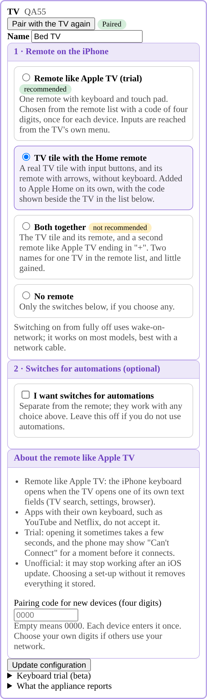

<p align="center"></p>

# homebridge-samsung-local

[](https://github.com/homebridge/homebridge/wiki/Verified-Plugins)
[](https://www.npmjs.com/package/homebridge-samsung-local)
[](https://www.npmjs.com/package/homebridge-samsung-local)
[](https://github.com/Abdulazizruh/homebridge-samsung-local/actions/workflows/ci.yml)
[](LICENSE)

Local, cloud-free control of Samsung appliances from Apple Home: air conditioners, washer status with a cycle-finished notice, and TVs with the Control Centre remote.

**Apple Home → Homebridge → the appliance, directly over your home network.**
No SmartThings API subscription, no Home Assistant, no HACS, no MQTT.

[العربية](README.ar.md)

> **Status: 1.3.2. Tested on real appliances.** Running daily in one home on five air conditioners from two model families (`ARTIK051_PRAC_20K` and `TP1X_DA-AC-RAC-01001`), one washer and four TVs, with Homebridge in Docker on a Raspberry Pi. The plugin shows the features your own appliance reports, so the result depends on the target appliance. See [What has been tested](#what-has-been-tested).
> Unofficial project. Not affiliated with, endorsed by or supported by Samsung.

## What it does

| | |
|---|---|
| Connection | Air conditioners and washers: CoAP over DTLS on the LAN. TVs: the TV's own local remote-control channel |
| Engine | You choose one in the settings. **JavaScript**: nothing to prepare. **Python**: the [`smartthings-local`](https://github.com/QuiteYellow/SmartThings-Local) library in a private environment. Both do the same job; each appliance shows its measured command response time with the engine in use, so you can compare them on your own appliances |
| Setup | Press **Scan the network** in the plugin settings and tick what to add, or enter one IP or MAC address and press **Test & discover** |
| Identity | Each appliance is keyed on its own stable device ID, so a new IP address never creates a duplicate. An air conditioner or washer whose address changes is found again by itself |
| Updates | Push (CoAP Observe) where the appliance supports it, polling every 15 s as fallback |
| Works offline | Yes, after the one-time setup below |
| Runs beside | `homebridge-smartthings-oauth` and any other plugin, without touching their files |

### Supported appliances

| Appliance | Level | Notes |
|---|---|---|
| Air conditioners (incl. WindFree; `ARTIK051_PRAC_20K`, `TP1X_DA-AC-RAC-01001`) | **Tested on real units** | Full HomeKit accessory, mapped from LocalThings' data |
| Washers | **Tested on one washer**, read only | A tile that shows the cycle running and the time remaining, a sensor that turns on when the cycle ends (for notifications), power and energy in Eve. Optional: progress, child lock status, fault alert. The cycle is started at the appliance; nothing is sent to it |
| Dryers, dishwashers | **Same follow-up, not yet tried on a real one** | Built on the same readings as the washer |
| Refrigerators, ovens, … | **Diagnostics only** | Connects and lists what the appliance reports |
| Samsung TVs (Tizen, 2016 and later) | **Tested on four TVs** | Paired once from the settings page while you stand in front of the TV (choose "Allow" on its screen). Appears either as a TV tile with the Control Centre remote, or as switches inside the bridge: power, mute, volume |
| Older appliances with only TCP 8888 | **Not supported** | Detected and reported |
| Appliances that refuse the automatic certificate | **Not supported** | Detected and reported with the reason |

An IP address alone is **not** enough for every appliance. Discovery only reports success after it has read the appliance's identity and resources over an authenticated session.

## Requirements

| Requirement | Detail |
|---|---|
| Homebridge | 2.x (tested on 2.5). 1.8+ is expected to work but is untested |
| Node.js | 22.12 or newer, or 24 |
| Connection engine | Chosen in the plugin settings. **JavaScript** works as installed and needs nothing else. **Python** needs Python **3.11 or newer** with `venv` and `pip` |
| CPU | 64-bit ARM (Raspberry Pi 4/5 with a 64-bit OS) or x86-64. **32-bit systems are not supported** (no prebuilt packages) |
| Network | The Homebridge host must reach the appliances directly. In Docker use `network_mode: host` |

The rest of this section applies to the Python engine only. The **official Homebridge Docker image (Ubuntu 24.04 based) already contains Python 3.12, pip and venv**, so nothing extra is needed there. The older Ubuntu 22.04 variant of the image ships Python 3.10, which is too old.

On first start the plugin creates a private Python environment in `<homebridge storage>/samsung-local/venv` and downloads pinned packages into it (about 32 MB). It runs as the Homebridge user, needs no root, and installs nothing system-wide. Nothing is installed during `npm install`.

### Outbound connections

| When | Where | Why |
|---|---|---|
| Python engine only: first start, and after a plugin update that changes the pins | `pypi.org`, `files.pythonhosted.org` | Download the pinned Python packages. The JavaScript engine downloads nothing |
| Normal operation | none | Only the appliances on your LAN are contacted |
| You press **Scan the network** in the settings | every address of your home network (its /24) and the OCF group address `224.0.1.187`: UDP 5683 for appliances, TCP 8001 for TVs; then one read of each new appliance found | Only when you press the button, never in the background. Nothing is added or stored before you confirm, and nothing leaves your network. |
| An appliance stopped answering (optional, on by default) | every address of the home network it was on (its /24), UDP 5683 | One small question to find the appliance at its new address, at most once every five minutes. Nothing leaves your network. Switch it off under General → "Find an appliance again when its address changes" |
| Samsung TVs | the TV itself, TCP 8001 and 8002; one wake-on-network packet to switch it on | Local remote-control channel of the TV |

The client certificate is generated on your machine. Its private key never leaves it and is stored with `0600` permissions in `samsung-local/credentials`.

## Install

Search for **Samsung Local** in the Homebridge **Plugins** tab and install.

Or, in the Homebridge terminal:

```sh
cd /var/lib/homebridge
npm install --save homebridge-samsung-local
```

Then restart Homebridge.

## Set up

1. Open the plugin settings and choose the connection engine. JavaScript works straight away. With Python, press **Prepare now** if its runtime is not ready yet.
2. Add your appliances, in either of two ways:
   - **Automatic scan:** press **Scan the network**. The plugin looks once across your home network, reads what each appliance it finds is, and lists them. Tick the ones you want and press **Add selected**. A TV asks for one approval on its screen first. Appliances already in your list are shown as added and left alone.
   - **By hand:** enter the appliance IP address, or its MAC address, and press **Test & discover**.
3. Added by hand: right under the address field, give it a name (optional) and tick what should appear in HomeKit. The table of functions the appliance reports is under that.
4. Press **Add to configuration**.
   A TV asks for one more step before that: press **Pair with the TV** and choose "Allow" on the TV screen.
5. On the plugin card open **⋮ → Bridge Settings** and enable the **child bridge**. Restart, then scan the child bridge's own QR code in the Home app.

The settings page shows these steps with a tick beside each one that is done, the version, the engine in use and how many appliances are connected.

<p></p>

### Automatic scan

Tested on a real home network: five air conditioners, a washer and a TV answered in one scan.

**Start.** The "Add an appliance" card offers both ways. **Scan the network** looks once, for about 15 seconds.

<p></p>

**Result.** Each appliance that answered is listed with its address. The ones already in your list are marked "Already added" and left alone. The line above the list says how many addresses are alive on the network and how many answered as appliances and TVs.

<p></p>

**A new appliance.** A new one is read, shown with its kind and model, and ticked as "Ready to add". Press **Add selected**; its name and options are then under its row in the list. (Example row added to the picture above.)

<p></p>

Running as a child bridge gives this plugin its own HomeKit pairing, its own QR code and its own cache files. Accessories are named exactly as you type them, so pick names that differ from the ones your existing plugin uses. Seeing the same appliance twice (once per bridge) during a trial is expected.

A static DHCP lease for each appliance is recommended. An air conditioner or washer whose address changes is found again by the plugin. To set an address yourself, press **Change IP** beside the appliance, enter the new one and press **Test & discover**: the existing entry is updated.

### Testing beside LocalThings

An appliance may accept only one local connection at a time. If LocalThings (or another local integration) is connected to the same appliance, discovery can time out or both sides can keep dropping. For a clean test, disable that appliance's entry in LocalThings first, then discover it here. This plugin never stops another integration and never changes anything in SmartThings.

Keep appliances registered in the SmartThings app: an appliance removed from SmartThings resets its Wi-Fi settings.

## How it appears in Apple Home

One accessory per air conditioner, holding these services (each only if the appliance reports the function, and each can be switched off per appliance):

| Function | HomeKit service | Shown in | Notes |
|---|---|---|---|
| Power, Cool / Heat / Auto, target and current temperature | Thermostat | Apple Home | Celsius. Range and step come from the appliance |
| Dry, Fan Only | Two switches | Apple Home | HomeKit thermostats have no state for these modes |
| Fan speed Low / Medium / High / Turbo | Fan slider (4 steps) | Apple Home | |
| Fan **Auto** | A dedicated switch, the fan "Auto" control, and 0 % on the slider | Apple Home | The slider shows Auto as 0 % |
| Fan **Turbo** | Dedicated switch (and the top slider step) | Apple Home | |
| Swing | Fan oscillation | Apple Home | On/off only; HomeKit has no vertical/horizontal choice |
| WindFree, Fast, Quiet (optional: Sleep, Smart, Comfort, 2-Step, wind follows / avoids people) | Switches | Apple Home | One comfort mode at a time, as on the appliance |
| Light Display | Light | Apple Home | On/off only. Brightness is not available locally |
| Humidity | Humidity sensor | Apple Home | Hidden while the appliance reports 0 |
| Filter | Filter maintenance | Apple Home | Change indication and remaining life |
| Beep, Auto Clean | Switches (off by default) | Apple Home | |
| Power now (W), energy total (kWh) | Eve characteristics on the thermostat | Eve-compatible apps and the plugin settings page | Apple Home has no power or energy type. No misleading sensor type is used |
| Alarms / error codes | — | Plugin settings page and log | |
| Voltage, current | — | — | Not reported by the air conditioners on record |
| Motion / occupancy | — | — | No known local resource carries the detection result |
| Everything else the appliance reports | — | Diagnostics download | Redacted, so it can be supported later |

Behaviour rules:

- Turning **off** WindFree, Fast or Quiet never powers the air conditioner off, and turning off a mode that is not active does nothing.
- The fan tile cannot power the air conditioner off (HomeKit sends "off" when the slider is dragged to zero).
- A command is reported as successful only after the appliance acknowledged it. A refused command shows as failed. If the appliance acknowledges but does not apply a change, HomeKit returns to the real state within seconds.
- Some air conditioners now and then answer a correct command with a refusal (4.00). The plugin asks once more; the log says when this happened and how it ended.
- Switching off from Apple Home shows on every tile of the air conditioner at once.
- One command, one beep: only a real change is sent. Switching on in the mode the unit was left in sends the power command alone, the same request arriving through several tiles is sent once, and a value the appliance already has is not sent again.
- Changes made with the remote or the Samsung app appear in HomeKit.
- When an appliance is unreachable its accessory shows **No Response** and is kept. Accessories are only removed when you remove the appliance from the plugin settings.

Differences from `homebridge-smartthings-oauth`: the layout (thermostat + fan + optional-mode switches + light + humidity) is the same idea. The display light has no brightness here.

### An air conditioner in Apple Home

The thermostat: target temperature, current temperature, humidity and the mode.

<p></p>

The parts of the same air conditioner. Each one can be switched off in the plugin settings.

<p></p>

### A washer in Apple Home

The cycle tile is on while a cycle runs, with the time remaining inside it. The sensor turns on when the cycle has finished, for a notification or an automation. On a washer that announces the end of a cycle itself, only that announcement turns the sensor on, so a cancelled cycle gives no notice. The washer is read only; nothing is sent to it.

<p></p>

### A Samsung TV in Apple Home

As a TV tile the TV has its own power button and input list.

<p></p>

The remote is in Control Centre: open the remote and choose the TV at the top. Volume up and down are the side buttons of the iPhone or iPad while the remote is open.

<p></p>

Apple wants every TV tile added on its own. After you add the TV in the plugin settings, its code appears beside it in the list of configured appliances (see [the TV options](#tv-options) below).

Give each TV a fixed address in your router (a DHCP reservation). An air conditioner or washer whose address changes is found again by the plugin; a TV is not, because a TV that is switched off does not answer at all and cannot be told apart from one that moved. If a TV's address does change, press **Change IP** beside it.

## Options for each appliance

Every appliance has its own options. Press **Options** under it in the plugin settings: they open right there, under the appliance. Tick what you want to see in Apple Home, then press **Update configuration**. Only the functions your own appliance reports are offered. A part you switch off is removed from Apple Home; the rest stays as it is.

A name is changed in place with the pencil beside it. **Remove** asks to be pressed twice.

### Air conditioner options

Fan tile, mode switches, WindFree, Fast, Quiet, Light Display, humidity, filter, power and energy.

<p></p>

### Washer options

Cycle tile with time remaining, cycle finished sensor, progress, child lock status, fault alert, and how the cycle tile behaves when tapped.

<p></p>

### TV options

Above the options is the TV's code for the Home app. **Scan the picture** with the iPhone or iPad camera from the Home app (+ → Add Accessory), **or type the digits by hand** (More options → pick the TV). Either way works. The code in the picture is an example.

Under it: the TV's name, and whether it appears as a TV tile with the remote or as switches inside the bridge.

<p></p>

## What has been tested

| Kind of test | Status |
|---|---|
| Unit and simulation tests (95 JavaScript, 17 Python): discovery, state and command translation, units, Auto/Turbo, comfort-mode exclusivity, external changes, reconnect, restart while offline, IP change, independence from the existing plugin, wipe and reinstall | **Pass** |
| Real Homebridge 2.5 run as a child bridge on x86-64: runtime preparation, helper start and stop, retry with backoff, own pairing and cache files, other plugins' files untouched | **Pass** |
| Samsung TVs as a TV tile, on four different TVs, newer and older, one of which does not work with SmartThings: pairing on the TV screen, adding to the Home app, the Control Centre remote (arrows, back, mute, volume with the device's side buttons, inputs) | **Pass** (four TVs) |
| Adding an appliance by its MAC address instead of its IP address, on a real home network: the plugin found the address itself | **Pass** |
| ARM64 package availability for the pinned Python packages (Python 3.11 and 3.12) | **Checked** |
| Install from the Homebridge plugin search inside the Docker container on a Raspberry Pi (ARM64, Python 3.12) | **Pass** |
| Discovery, live readings and push updates on real air conditioners | **Pass** on five units across two model families (`ARTIK051_PRAC_20K`, `TP1X_DA-AC-RAC-01001`) |
| Control from Apple Home (power, temperature, fan, modes) | **Confirmed on all five units** |
| Reconnect on real hardware | **Pass**: short drops recover within seconds |
| A washer (`DA_WM_TP1_21_COMMON`) | **Confirmed on the real washer**: running state, wash stage, time remaining and the cycle-finished notice |
| Both engines on the same six appliances (five air conditioners and the washer) | **Pass**: both connect to all six and receive push updates. In a start-up comparison Python connected about one second sooner |
| A command refused with 4.00 and asked once more | **Confirmed on a real air conditioner**: accepted on the second ask |

**It depends on your appliance.** Each model reports its own set of features. Use "Test & discover" in the settings: the table it shows is what your own appliance reports, and that is what appears in Apple Home.

## Diagnostics

- Plugin settings → **Diagnostics** downloads a redacted dump (no serial numbers, MAC or IP addresses, device IDs, Wi-Fi names or keys). TVs have none.
- Once every 24 hours the log states, for each appliance, how many times the connection was lost and the longest gap. Restarts of the bridge are not counted.
- Each connection is logged with the time it took.
- Enable Homebridge debug mode for detailed logs. Certificates and keys are never logged.

## Update

Use the Homebridge Plugins tab. The settings, the certificate and the accessories are kept.

## Remove

1. In the Home app, remove the **child bridge** of this plugin (long-press the bridge → Remove Bridge). Uninstalling the plugin does **not** remove its pairing from the Home app. A TV added as a TV tile is its own accessory: remove each one in the Home app as well.
2. Optional: plugin settings → **Delete data**. This deletes only the `samsung-local` folder (certificate, cached readings, TV pairings, Python runtime).
3. Uninstall from the Homebridge Plugins tab. When the plugin stops, its helper process stops with it; nothing keeps running.

Removal never touches other plugins, Home Assistant, the appliances' network settings or their SmartThings registration.

## Moving from the existing plugin

See [docs/MIGRATION.md](docs/MIGRATION.md). Apple Home automations do **not** move automatically.

## Credits and licences

MIT. Built on [SmartThings-Local](https://github.com/QuiteYellow/SmartThings-Local) (MIT, Jack Nagy) and the appliance maps of [LocalThings](https://github.com/mbillow/localthings) (MIT, Marc Billow). The JavaScript engine uses the transport of [homebridge-samsung-ocf](https://github.com/aziz66/homebridge-samsung-ocf) (MIT). HomeKit layout inspired by [homebridge-smartthings-oauth](https://github.com/aziz66/homebridge-smartthings) (Apache-2.0). Details in [THIRD_PARTY_NOTICES.md](THIRD_PARTY_NOTICES.md).

"Samsung" and "SmartThings" are trademarks of Samsung Electronics Co., Ltd., used only to name the hardware this software works with.
