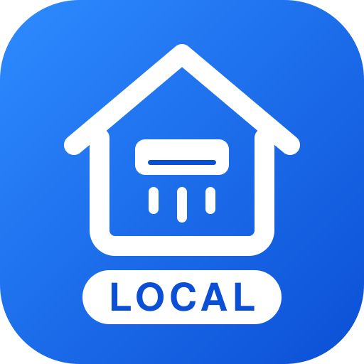

<p align="center"></p>

# homebridge-samsung-local

Local, cloud-free control of Samsung SmartThings-compatible appliances from Apple Home.

**Apple Home → Homebridge → the appliance, directly over your home network.**
No SmartThings API subscription, no Home Assistant, no HACS, no MQTT.

[العربية](README.ar.md)

> **Status: 1.0.1.** Running on one real air conditioner (`ARTIK051_PRAC_20K`, Homebridge in Docker on a Raspberry Pi). Other models and appliance types are unconfirmed. See [What has been tested](#what-has-been-tested).
> Unofficial project. Not affiliated with, endorsed by or supported by Samsung. Not a Homebridge Verified plugin.

## What it does

| | |
|---|---|
| Connection | CoAP over DTLS on the LAN, through the [`smartthings-local`](https://github.com/QuiteYellow/SmartThings-Local) library |
| Setup | Enter an IP address in the plugin settings, press **Test & discover** |
| Identity | Each appliance is keyed on its own stable device ID, so a new IP address never creates a duplicate |
| Updates | Push (CoAP Observe) where the appliance supports it, polling every 15 s as fallback |
| Works offline | Yes, after the one-time setup below |
| Runs beside | `homebridge-smartthings-oauth` and any other plugin, without touching their files |

### Supported appliances

| Appliance | Level | Notes |
|---|---|---|
| Air conditioners (incl. WindFree, `ARTIK051_PRAC_20K`) | **Experimental** | Full HomeKit accessory, mapped from LocalThings' data |
| Washers, dryers, refrigerators, ovens, … | **Diagnostics only** | Connects, lists what the appliance reports, creates no HomeKit accessory yet |
| Samsung TVs | **Not supported** | TVs need an OCF credential owners cannot obtain yet. Keep them on your current plugin |
| Older appliances with only TCP 8888 | **Not supported** | Detected and reported |
| Appliances that refuse the automatic certificate | **Not supported** | Detected and reported with the reason |

An IP address alone is **not** enough for every appliance. Discovery only reports success after it has read the appliance's identity and resources over an authenticated session.

## Requirements

| Requirement | Detail |
|---|---|
| Homebridge | 2.x (tested on 2.5). 1.8+ is expected to work but is untested |
| Node.js | 22.12 or newer, or 24 |
| Python | **3.11 or newer** with `venv` and `pip` |
| CPU | 64-bit ARM (Raspberry Pi 4/5 with a 64-bit OS) or x86-64. **32-bit systems are not supported** (no prebuilt packages) |
| Network | The Homebridge host must reach the appliances directly. In Docker use `network_mode: host` |

The **official Homebridge Docker image (Ubuntu 24.04 based) already contains Python 3.12, pip and venv**, so nothing extra is needed there. The older Ubuntu 22.04 variant of the image ships Python 3.10, which is too old.

On first start the plugin creates a private Python environment in `<homebridge storage>/samsung-local/venv` and downloads pinned packages into it (about 32 MB). It runs as the Homebridge user, needs no root, and installs nothing system-wide. Nothing is installed during `npm install`.

### Outbound connections

| When | Where | Why |
|---|---|---|
| First start, and after a plugin update that changes the pins | `pypi.org`, `files.pythonhosted.org` | Download the pinned Python packages |
| Normal operation | none | Only the appliances on your LAN are contacted |

The client certificate is generated on your machine. Its private key never leaves it and is stored with `0600` permissions in `samsung-local/credentials`.

## Install

Search for **Samsung Local** in the Homebridge **Plugins** tab and install.

Or, in the Homebridge terminal:

```sh
cd /var/lib/homebridge
npm install --save homebridge-samsung-local
```

Then restart Homebridge.

## Set up

1. Open the plugin settings. If the Python runtime is not ready yet, press **Prepare now**.
2. Enter the appliance IP address and press **Test & discover**.
3. Review the table of functions the appliance reports, give it a name (optional) and tick what should appear in HomeKit.
4. Press **Add to configuration**.
5. On the plugin card open **⋮ → Bridge Settings** and enable the **child bridge**. Restart, then scan the child bridge's own QR code in the Home app.

Running as a child bridge gives this plugin its own HomeKit pairing, its own QR code and its own cache files. Accessories are named with the suffix **Local** so they are easy to tell apart from the ones your existing plugin provides. Seeing the same appliance twice (once per bridge) during a trial is expected.

A static DHCP lease for each appliance is recommended. If an address changes, enter the new one and press **Test & discover**: the existing entry is updated.

### Testing beside LocalThings

An appliance may accept only one local connection at a time. If LocalThings (or another local integration) is connected to the same appliance, discovery can time out or both sides can keep dropping. For a clean test, disable that appliance's entry in LocalThings first, then discover it here. This plugin never stops another integration and never changes anything in SmartThings.

Keep appliances registered in the SmartThings app: an appliance removed from SmartThings resets its Wi-Fi settings.

## How it appears in Apple Home

One accessory per air conditioner, holding these services (each only if the appliance reports the function, and each can be switched off per appliance):

| Function | HomeKit service | Shown in | Notes |
|---|---|---|---|
| Power, Cool / Heat / Auto, target and current temperature | Thermostat | Apple Home | Celsius. Range and step come from the appliance |
| Dry, Fan Only | Two switches | Apple Home | HomeKit thermostats have no state for these modes |
| Fan speed Low / Medium / High / Turbo | Fan slider (4 steps) | Apple Home | |
| Fan **Auto** | A dedicated switch, the fan "Auto" control, and 0 % on the slider | Apple Home | The slider shows Auto as 0 % |
| Fan **Turbo** | Dedicated switch (and the top slider step) | Apple Home | |
| Swing | Fan oscillation | Apple Home | On/off only; HomeKit has no vertical/horizontal choice |
| WindFree, Fast, Quiet (optional: Sleep, Smart, Comfort, 2-Step, wind follows / avoids people) | Switches | Apple Home | One comfort mode at a time, as on the appliance |
| Display light | Light | Apple Home | On/off only. Brightness is not available locally |
| Humidity | Humidity sensor | Apple Home | Hidden while the appliance reports 0 |
| Filter | Filter maintenance | Apple Home | Change indication and remaining life |
| Beep, Auto Clean | Switches (off by default) | Apple Home | |
| Power now (W), energy total (kWh) | Eve characteristics on the thermostat | Eve-compatible apps and the plugin settings page | Apple Home has no power or energy type. No misleading sensor type is used |
| Alarms / error codes | — | Plugin settings page and log | |
| Voltage, current | — | — | Not reported by the air conditioners on record |
| Motion / occupancy | — | — | No known local resource carries the detection result |
| Everything else the appliance reports | — | Diagnostics download | Redacted, so it can be supported later |

Behaviour rules:

- Turning **off** WindFree, Fast or Quiet never powers the air conditioner off, and turning off a mode that is not active does nothing.
- The fan tile cannot power the air conditioner off (HomeKit sends "off" when the slider is dragged to zero).
- A command is reported as successful only after the appliance acknowledged it. A refused command shows as failed. If the appliance acknowledges but does not apply a change, HomeKit returns to the real state within seconds.
- Changes made with the remote or the Samsung app appear in HomeKit.
- When an appliance is unreachable its accessory shows **No Response** and is kept. Accessories are only removed when you remove the appliance from the plugin settings.

Differences from `homebridge-smartthings-oauth`: the layout (thermostat + fan + optional-mode switches + light + humidity) is the same idea. The display light has no brightness here, and washers and TVs are not exposed yet.

## What has been tested

| Kind of test | Status |
|---|---|
| Unit and simulation tests (43 JavaScript, 6 Python): discovery, state and command translation, units, Auto/Turbo, comfort-mode exclusivity, external changes, reconnect, restart while offline, IP change, independence from the existing plugin, wipe and reinstall | **Pass** |
| Real Homebridge 2.5 run as a child bridge on x86-64: runtime preparation, helper start and stop, retry with backoff, own pairing and cache files, other plugins' files untouched | **Pass** |
| ARM64 package availability for the pinned Python packages (Python 3.11 and 3.12) | **Checked** |
| Install from the Homebridge plugin search inside the Docker container on a Raspberry Pi (ARM64, Python 3.12) | **Pass** (one installation) |
| Discovery and live readings on a real `ARTIK051_PRAC_20K` air conditioner | **Pass** (one unit) |
| Control from Apple Home on that unit | **Reported working by its owner**; not yet checked function by function |
| Other air-conditioner models, long-running stability, reconnect on real hardware | **Not done** |

Air-conditioner support is therefore still **experimental**: it rests on one unit. The resource maps come from LocalThings, which records what was measured on real units, but an advertised mode is not proof that writing it works on your unit.

## Diagnostics

- Plugin settings → **Diagnostics** downloads a redacted dump (no serial numbers, MAC or IP addresses, device IDs, Wi-Fi names or keys).
- Enable Homebridge debug mode for detailed logs. Certificates and keys are never logged.

## Update

Use the Homebridge Plugins tab. The settings, the certificate and the accessories are kept.

## Remove

1. In the Home app, remove the **child bridge** of this plugin (long-press the bridge → Remove Bridge). Uninstalling the plugin does **not** remove its pairing from the Home app.
2. Optional: plugin settings → **Delete data**. This deletes only the `samsung-local` folder (certificate, cached readings, Python runtime).
3. Uninstall from the Homebridge Plugins tab. When the plugin stops, its helper process stops with it; nothing keeps running.

Removal never touches other plugins, Home Assistant, the appliances' network settings or their SmartThings registration.

## Moving from the existing plugin

See [docs/MIGRATION.md](docs/MIGRATION.md). Apple Home automations do **not** move automatically.

## Credits and licences

MIT. Built on [SmartThings-Local](https://github.com/QuiteYellow/SmartThings-Local) (MIT, Jack Nagy) and the appliance maps of [LocalThings](https://github.com/mbillow/localthings) (MIT, Marc Billow). HomeKit layout inspired by [homebridge-smartthings-oauth](https://github.com/aziz66/homebridge-smartthings) (Apache-2.0). Details in [THIRD_PARTY_NOTICES.md](THIRD_PARTY_NOTICES.md).

"Samsung" and "SmartThings" are trademarks of Samsung Electronics Co., Ltd., used only to name the hardware this software works with.
